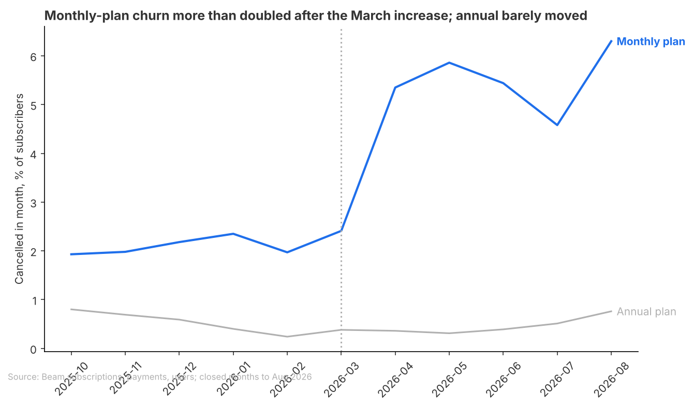
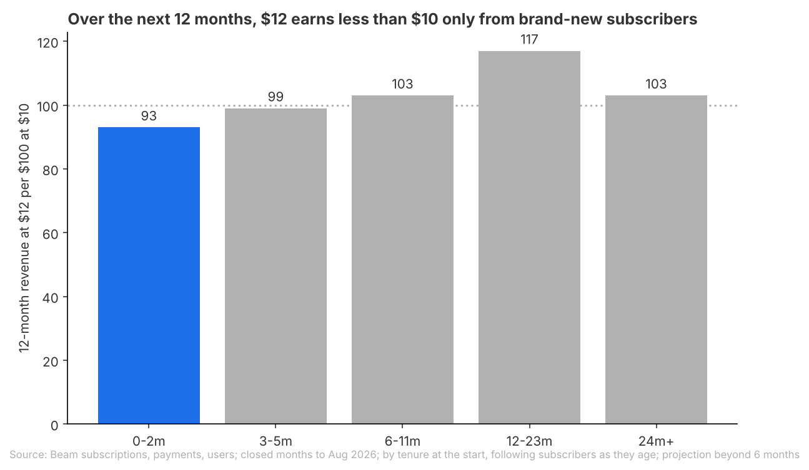

# Brief: Roll back the March price rise for new subscribers only

## Question
Should Beam roll back part of the March 2026 monthly price rise ($10 to $12), and if so, for which customers?

## Recommendation
**Test a return to $10 for new monthly subscribers, on part of new sign-ups, and keep $12 for everyone else.**
Subscribers in their first months cancel much faster at $12, so over a year Beam earns about $93 from them for every $100 it earned at $10; every other group earns about as much or more at $12.
Fairly confident: the price clearly drove the extra cancellations, but the one-year revenue is projected from six months of data, and no rollback has been tried, so we do not yet know that $10 wins these subscribers back.
What would change this: if the test shows new subscribers at $10 still cancel at the higher rate, keep $12 for them too.

**Open for you**
- Can Beam charge new subscribers a different price from existing ones, in billing and without an existing-customer backlash you would not accept?
- Do you weigh the second year as much as the first? Over two years, $12 also earns less from the longest-standing subscribers (see the third finding).

## Key Takeaways
- Monthly-plan churn (the share of paying monthly subscribers who cancel in a month) rose from 2.1% to 5.0% after the rise, comparing subscribers at the same tenure; annual-plan churn, whose price did not change, stayed flat.
- New subscribers are the only group where $12 brings in less within a year: about $93 for every $100 at $10.
- No country or device stands out once revenue is counted: EU and Android cancel a little more than the rest, but their revenue at $12 is level with $10, so there is no case for a rollback by country or device.

## Findings
### The price rise more than doubled monthly-plan churn

- Monthly-plan churn went from 2.1% to 5.0% a month at the same tenure. Annual-plan churn did not move, which puts the price effect at about 2.9 points (range 2.6 to 3.3).
- Season does not explain it: a second measure, monthly payments that stop, rose from 0.8% in the same months of 2025 to 5.0% after the rise.
- The rise still pays in cash today: monthly-plan revenue went from about $50,000 in February to $67,000 in March and held there through August.
- Limit: some of these "cancellations" may be subscribers moving to the annual plan, which the data cannot show; if so, the true loss is smaller.

### New subscribers are where $12 loses money

- Subscribers in their first three months cancel at 8.7% a month against 2.6% before; those who joined at $12 cancel at 10.1% a month against 2.7% for earlier joiners at the same tenure.
- At $12 they still bring in more over their first six months ($104 per $100), but less over a year ($93, range $90 to $96) and two years ($82), because so many leave early.
- Limit: the one-year and two-year figures are projections that assume today's cancellation rates continue. A jump in sign-ups in July 2026 cancelled especially fast, but the early-cancellation rise holds without July.

### Longer-standing subscribers still earn more at $12 for now
**$103 at $12 for every $100 at $10 over a year, for subscribers of 24 months or more**
- Their churn rose the most in relative terms (0.9% to 3.8% a month), yet the extra $2 still outweighs the loss over a year, and subscribers of 12 to 23 months earn $117 per $100.
- Limit: over two years the projection turns against $12 for the longest-standing group ($88 per $100) and for monthly subscribers overall, where $12 stops out-earning $10 after month 15. Recheck this group once more months are closed.

## Appendix
### How this was done
- Data: Beam subscriptions, payments and users, closed months to August 2026 (September 2026 is open; data ends 2026-09-24).
- Population: paying monthly-plan subscribers; free plans, future-dated starts and months with no payment yet are left out. Annual-plan subscribers over the same months are the comparison group.
- Window: before the rise November 2025 to February 2026; after March to August 2026. October 2025 is left out because end dates were still recorded the old way; adding it moves the headline from 2.9 to 3.0 points.
- Measure: monthly churn per subscriber-month, with the before rate reweighted to the after-period tenure mix (0-2, 3-5, 6-11, 12-23, 24+ months), so each group is only compared with subscribers at the same tenure. Groups whose before period has no subscribers at a tenure take the all-subscriber rate for it.
- Comparison: each group's rise against everyone else's, and revenue per 100 subscribers at $12 against $10 over 6, 12 and 24 months. For tenure, subscribers are followed as they age into later tenure bands. Ranges are 95% bootstrap ranges over 200 resamples of subscribers, not adjusted for testing 16 groups.

### Sources
- The price rise more than doubled monthly-plan churn: data/headline.csv, data/headline_vs_annual.csv, data/monthly_churn_series.csv, data/payment_lapse_comparison.csv, data/monthly_plan_revenue.csv; analysis.py (tenure-matched comparison, payment-based churn, charts)
- New subscribers are where $12 loses money: data/revenue_by_starting_tenure.csv, data/groups.csv (tenure_band 0-2m, cohort "Started after the increase"); analysis.py (groups, Tenure follow-through, charts)
- Longer-standing subscribers still earn more at $12 for now: data/revenue_by_starting_tenure.csv, data/groups.csv (tenure_band 24m+), data/revenue_horizons.csv, data/breakeven.csv; analysis.py (groups, Revenue, overall)
- Key takeaway on country and device: data/groups.csv (country EU, device Android; rev12_index, rev12_low/high, rev12_call); analysis.py (groups)

### Checks
- Checked: a rerun of a copy matched all result tables; joins do not duplicate rows; group counts sum to the total in every dimension; end dates are recorded steadily from November 2025 (asserted in the script); date boundaries, closed months only, dates compared as dates; country and device mix of new monthly subscribers stable across the periods; all four charts opened.
- Not checked: why monthly payments stopped without an end date in August to September 2025 (a switch, billing or recording); signup channel behind the July 2026 jump; whether time-of-day end dates mark user-initiated cancellations; how a $10 price for new subscribers would actually change their churn (no rollback in the data).
- Out of scope: annual plan pricing; trial design and conversion (trials began 2026-08-01, after the rise).
- Review findings (applied fixes C1 to A4 were rerun once but not re-reviewed by /validate):
  - C1 Small fix, payment-lapse baseline: applied, not re-reviewed. August and September 2025 are now left out of lapse baselines.
  - C2 Small fix, same-month starts and ends: applied, not re-reviewed. They are counted and printed for each period; they are still not at risk, so the early-tenure rise is slightly understated.
  - A1 Needs the user, which groups Beam can price separately and whether a rollback lowers churn: not verified. Carried to Open for you (pricing new subscribers separately) and to the Recommendation as a test (whether $10 brings churn back down).
  - A2 Small fix, revenue held at fixed tenure churn: applied, not re-reviewed. Revenue now follows subscribers as they age through tenure bands (revenue_by_starting_tenure.csv, revenue_12m_by_group.png). Country, device and cohort revenue still hold the group's after-period churn fixed.
  - A3 Small fix, no ranges on revenue: applied, not re-reviewed. Bootstrap ranges and a call per group (rev12_low, rev12_high, rev12_call in groups.csv); EU and Android are too close to call.
  - A4 Small fix, cohort chart title: applied, not re-reviewed. Retitled to say joiners at $12 are compared with earlier joiners at the same tenure, with the pooled comparison named in the source line.
  - A5 Note, July 2026 sign-up jump with faster early cancellation: stated as a limit next to the new-subscriber finding.
  - A6 Note, before and after periods are different seasons, and the annual comparison rests on few cancellations: handled by the 2025 payment-stop check in the first finding; the annual range is wide (-35% to +59% relative).
  - A7 Note, tenure and cohort overlap: the new-subscriber finding uses both as one story, not two.
  - A8 Note, switches from monthly to annual not visible: stated as a limit on the first finding.
  - A9 Note, status field and annual end-date timing: not cited; churn is read from monthly end dates.
