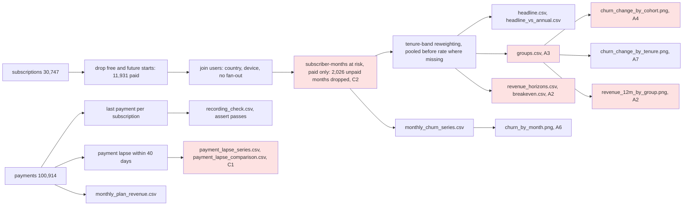

# Review: March 2026 price increase and retention (v2, second round)

## Verdict
**Think on it**: the rerun matches and the end-date baseline is now clean, but which groups Beam can roll back for still needs the user (A1), and the revenue projection that picks those groups could change the pick (A2, A3).

## Data flow

## Code review
- **C1 Small fix** The payment-lapse "season check" reads an August to September 2025 anomaly as season: lapses jump from about 30 a month to 141 and 183, and about two thirds of those have no end date within 45 days of the last payment, so they are not cancellations as recorded; the Mar to Aug 2025 "same season" baseline and the +89% "season" rise rest on that month. Where: analysis.py:288-317, payment_lapse_comparison.csv. Fix: test the lapse measure for a break, leave August and September 2025 out of lapse baselines (or show them both ways), and stop labelling Jan-Feb against Mar-Aug 2025 a season check.
- **C2 Small fix** Subscribers who start and end in the same calendar month are never at risk (`start_date < ms`) and are not counted as an exclusion; among Nov 2025 to Aug 2026 starters that is 4 before against 20 after, so the 0-2m rise is slightly understated. Where: analysis.py:114. Fix: count and print them, or let a subscriber be at risk from their start month.

## Analysis review
- **A1 Needs the user** Carried from round one and still open: the frame never asks which groups Beam can actually price separately (new subscribers, 24m+, EU and Android pass the churn test; tenure bands may not be targetable the way country is) or whether a rollback would bring churn back down. Where: frame.md. Fix: return to /frame.
- **A2 Small fix** The revenue arm of the decision rule holds each tenure band's after churn fixed for 12 and 24 months, so new subscribers (0-2m, 88 per 100 at 12 months) are charged first-months churn for a whole year instead of ageing into lower-churn bands; this decides whether new subscribers pass the rule. Where: analysis.py:181-191, revenue_12m_by_group.png, groups.csv. Fix: project revenue by following a starting cohort through the band rates, before and after.
- **A3 Small fix** Revenue differences and breakeven months carry no ranges, yet EU and Android pass the revenue arm by under 1% (10,814 against 10,888; 10,867 against 10,891), and their "rose more than the rest" calls are borderline among 16 unadjusted tests. Where: groups.csv. Fix: bootstrap each group's revenue difference by subscriber and mark groups whose call depends on noise.
- **A4 Small fix** The cohort chart title says churn "rose most" among post-increase starters, but they have no before period (100% pooled before rate; the spike cohort 81%): the bar compares $12 starters with earlier starters at the same tenure. Where: churn_change_by_cohort.png, analysis.py:342-348. Fix: retitle to say what is compared and show the pooled share on the chart.
- **A5 Note** July 2026 monthly starts more than doubled (491 against about 200 a month) and 21% cancelled within 60 days against 16% for Mar to Jun starters and 4% for Nov to Feb; country and device mix did not shift, and the early-churn rise holds without July.
- **A6 Note** Baseline (Nov to Feb) and after period (Mar to Aug) are different seasons; the annual control is flat (0.46% both periods) but rests on about ten cancellations a month (range -35% to +59%), and the Oct 2025 sensitivity moves the headline by under 0.1 points.
- **A7 Note** Tenure and cohort overlap: after March the 0-2m band is mostly post-increase starters and 6-11m mostly the spike cohort, so the two charts tell one story, not two.
- **A8 Note** Switches from monthly to annual (frame Open questions) are still not named in the outputs; the August to September 2025 payment stops without an end date (C1) may be such switches.
- **A9 Note** `status` changes meaning in August 2026 and annual end dates drift in time-of-day share (on about ten a month, with the gap to last payment stable); the analysis rightly reads churn from monthly end dates, and the brief should cite neither.

## Checked
- Rerun of a copy matches all 10 result CSVs; joins do not fan out; group at-risk counts sum to 31,805 in every dimension; round-one fixes are in (pooled before rate, Nov 2025 baseline with assert, paying subscribers only with the drop counted, bootstrap by subscriber).
- Dates: AS_OF 2026-09-24 used, never the real date; Nov 2025 to Feb 2026 against Mar to Aug 2026 with Oct 2025 as a sensitivity; September 2026 excluded as open; dates compared as dates; periods differ in length (4 against 6 months) and season (A6).
- Source data: `stable_over_time` over Nov 2025 to Aug 2026 finds monthly end dates recorded steadily (fixed 30-day share at 5% tolerance, gap to last payment, time of day at 25%), payment gaps and timing steady, amounts stepping to $12 on 2026-03-01 as expected; `status` breaks in Aug 2026 (unused); the payment-lapse measure breaks in Aug to Sep 2025, outside the headline windows but inside its same-season baseline (C1).
- Mix: country and device shares of monthly starters stable across Nov to Feb, Mar to Jun, Jul and Aug 2026; the July 2026 signup bump is named (A5).
- All four charts opened: titles match the data except the cohort chart (A4); the revenue chart rests on A2; the monthly chart's source line overlaps its month labels.

## Not checked
- Why monthly payments stopped without an end date in Aug to Sep 2025 (switch, billing or recording); no field says.
- Revenue under a cohort projection or with ranges (A2, A3); that is new analysis for /analyse.
- Whether time-of-day end dates mark user-initiated cancellations; no field records the cancellation type.
- Signup channel behind the July 2026 bump; users has no channel field.
