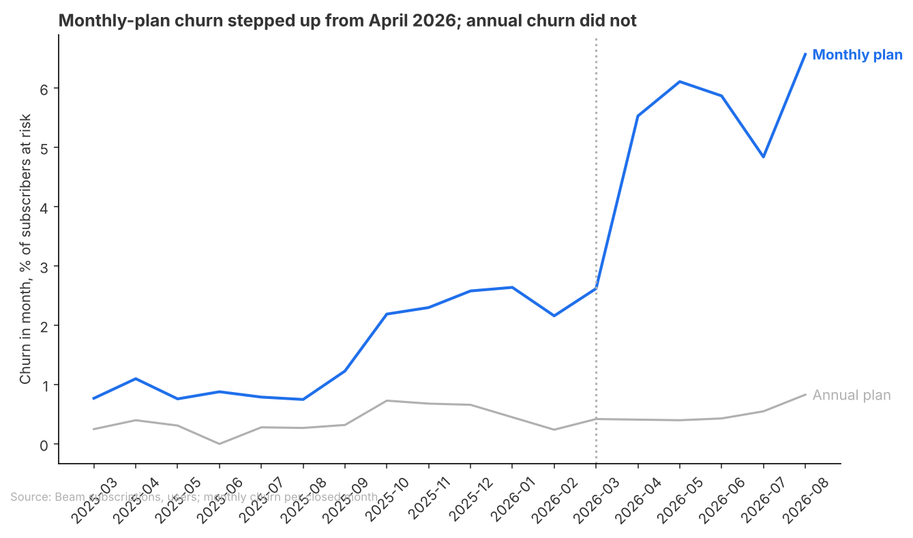
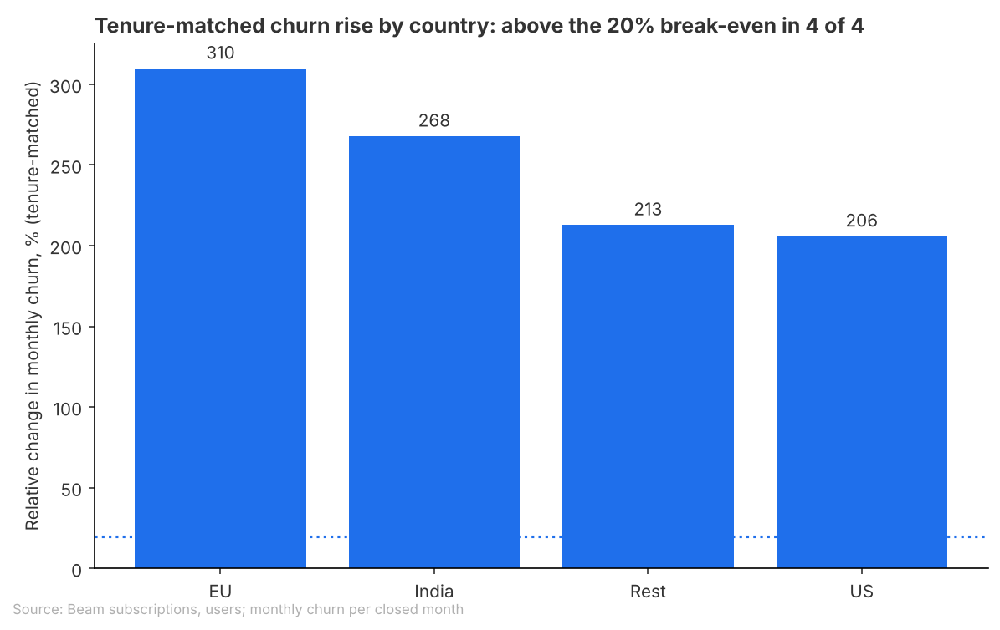
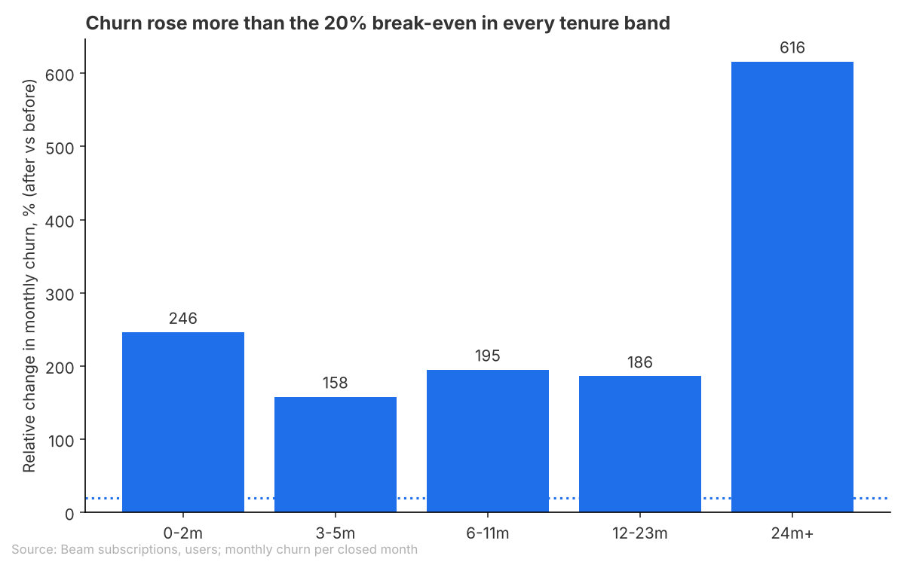

# Brief: March 2026 price increase and monthly-plan retention

## Question
Did the March 2026 monthly price increase ($10 to $12) lower retention of monthly subscribers, compared at the same tenure (how long they had been subscribed), and for which groups? It informs whether to roll back part of the increase for some customer groups.

## Recommendation
Do not pick groups for a partial rollback from these results. Monthly churn rose sharply after the increase in every tenure band, country and device, and no group stands out from the others, so the data gives no basis for targeting a rollback at some customers and not others. Whether to roll back at all is still open: it depends on which revenue measure you judge by, and part of the churn rise may come from something other than the price.

How sure: very sure that churn rose (at least +152% under every baseline, on about 1,700 subscribers who churned after the increase). Not sure how much of the rise the price caused, and the data cannot say who to target.

Next step: agree the decision rule and the revenue measure (questions below), then compare monthly against annual churn over the same months and rerun the tenure view without the September 2025 signup cohort, to separate the price effect from other changes.

**Open for you**
- A1: Which rule should pick the groups for a rollback? The agreed test ("churn rose more than 20%", the point where $2 more a month no longer makes up for lost subscribers) flags all 5 tenure bands, all 4 countries, all 3 devices and all 12 country and device pairs, so it cannot choose between them. Would "rose clearly more than the average group" or a revenue-at-risk cut-off fit how you would decide?
- A2: Which revenue measure decides it: realised revenue per month, revenue per signup cohort over a fixed period, or projected lifetime revenue per subscriber? They point in opposite directions (see Findings).
- A5: Did anything else change in October 2025 or August 2026? Churn had already risen in October 2025, and annual churn also rose in August 2026, when trials launched (2026-08-01).
- A6: Should a monthly subscriber who moved to the annual plan (or to free) count as churned? Switches cannot be seen in this data, and annual ($100) became relatively cheaper than twelve months at $12.

## Key Takeaways
- Monthly-plan churn rose from 0.80% to 5.25% a month (+4.5 percentage points, +557%) against the same months a year earlier, matched by tenure; against any other baseline the rise is still at least +152%.
- Every tenure band, country and device rose more than the 20% break-even, from +142% (US iOS) to +616% (subscribed 24 months or more); group differences overlap and are not a basis for targeting.
- Annual-plan churn, where the price did not change, rose far less: 0.37% to 0.51% a month (+38%, uncertain, range 0% to +90%).
- Revenue tells a different story: monthly-plan revenue was $66,636 in August 2026 against $49,970 in February 2026, with about the same number of subscribers at risk (5,402 against 5,382). The decision depends on which measure counts.

## Findings
### Monthly churn rose sharply after the increase, but had already started rising in October 2025

- Monthly churn ran at about 0.8% to 1.1% a month through August 2025, rose to 2.19% in October 2025 when the September 2025 signup spike came in, and reached 5.53% in April 2026 and 6.57% in August 2026.
- Annual churn also rose to 0.83% in August 2026, the month trials launched, so the chart title's "annual churn did not" holds only through July. Part of the after-period rise may not be the price (A5, above).

Source: data/monthly_churn_series.csv, analysis.py (subscriber-months, monthly series)

### The rise holds under every baseline
**+557%** (0.80% to 5.25% a month) against the same months a year earlier (March to August 2025)
- Against the six months just before (September 2025 to February 2026): +152% (2.09% to 5.25%). Against the twelve months before: +238% (1.55% to 5.25%). Without the September 2025 cohort: +302% (1.19% to 4.80%).
- The baseline changes the size, not the conclusion: every version is far above the 20% break-even. Intervals are approximate and likely too narrow (they treat each subscriber-month as independent).

Source: data/headline_baseline_range.csv, analysis.py (headline)

### Every group rose, and no group clearly differs

- Countries: EU +310% (approximate range +240% to +395%), India +268%, Rest +213%, US +206% (+167% to +250%). Devices: Android +271%, Web +246%, iOS +199%. The ranges overlap, so the order between groups is not a finding.
- The smallest rise among the 12 country and device pairs is US iOS at +142% (+89% to +211%), still above the break-even.

Source: data/segment_country.csv, data/segment_device.csv, data/segment_country_device.csv, analysis.py (segments)

### Churn rose in every tenure band, from very different starting points

- The longest-tenured (24 months or more) rose most in relative terms, +616%, but from a low base (0.53% to 3.82% a month, on 60 churned before). The newest (0 to 2 months) rose most in points: 2.51% to 8.68%, +6.2 percentage points.
- Without the September 2025 cohort, which only reaches 6 to 11 months in the after period, the newest bands rise more (0 to 2 months +413%, 3 to 5 months +265%) and 6 to 11 months less (+165%). Bands are wide and compared within band, not matched more finely. Very early churn is undercounted in both periods (subscriptions that end in their first month are never counted at risk; 35 of them).

Source: data/segment_tenure.csv, data/segment_tenure_no_sep2025_cohort.csv, analysis.py (segments)

### Lifetime revenue and realised revenue disagree
**0.35** projected lifetime revenue per subscriber after the increase, relative to before (1.0 = no change; twelve-month baseline)
- This measure ($12 divided by churn after, against $10 divided by churn before) says the increase cut revenue per subscriber by about two thirds. It ignores new signups and rests on six months of after-data.
- Realised monthly-plan revenue went the other way: $49,970 in February 2026, $67,032 in March, $66,636 in August, with the at-risk base flat (5,382 in February, 5,402 in August). Which measure decides is open (A2, above).

Source: data/headline_monthly_plan.csv, data/monthly_plan_revenue.csv, data/monthly_churn_series.csv, analysis.py (headline, revenue context)

## How this was done
- Data: Beam subscriptions joined to users (country, device) and payments. Monthly-plan, paying subscribers only; free plans and starts after 2026-09-24 left out.
- Measure: monthly churn, the share of subscribers active at the start of a month whose subscription ended in that month. Closed months only, March 2025 to August 2026 (September 2026 is incomplete).
- Comparison: after the increase (March to August 2026) against before, with the before rate reweighted to the after-period tenure mix in bands of 0 to 2, 3 to 5, 6 to 11, 12 to 23 and 24 or more months. Same-season baseline leads; others shown as a range. Annual-plan churn over the same months as a group the price did not touch.
- Break-even: churn has to rise more than 20% for the extra $2 a month to stop paying for itself over a subscriber's lifetime.
- Everyone paid $12 from March 2026: March revenue equals payments times $12.

## Checks
- Checked: the analysis was rerun and all 13 result files matched; no duplicate rows from the users join; segments add up to totals; only closed months used; dates compared as dates; free plans, future starts and the September 2025 cohort handled.
- Not checked: the wider window (from March 2025, approved in the plan) was accepted, not tested; no test of whether groups differ from each other; no cohort view or monthly-against-annual comparison yet.
- Out of scope: annual plan pricing; trial design (trials began 2026-08-01). Engagement segments were not possible: the activity table has no user id.
- Not verified: C1, the script now finds the repo root from the working directory; applied and rerun, not re-reviewed.
- Not verified: A3, the same-season baseline now leads, with all baselines in one table; applied and rerun, not re-reviewed.
- Not verified: A4, tenure shown with and without the September 2025 cohort and the tenure chart title no longer ranks bands; applied and rerun, not re-reviewed.
- Plan switches (A6): 0 of 11,122 paid subscriptions have both monthly and annual payments, so switches do not show in payments either.
