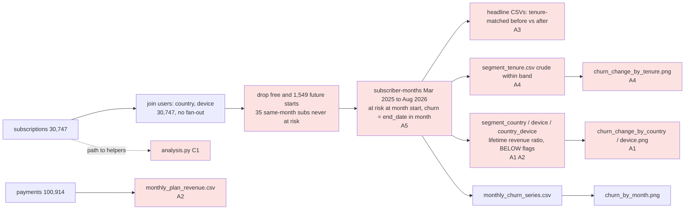

# Review: March 2026 price increase and monthly-plan retention

## Verdict
**Think on it**: monthly churn clearly rose after the increase under every baseline, but the rollback rule flags all 12 country/device groups, so it cannot say for whom to roll back.

## Data flow

## Code review
- **C1 Small fix** The script finds the repo root as `parents[2]` of its own path, so a copy in `rerun/` cannot import `helpers` and the rerun failed until `PYTHONPATH` was set to the repo root. Where: analysis.py:13. Fix: locate the repo root from the working directory (the script already reads `data/` relative to it) or search upward for `helpers/`.
- **C2 Note** Subscriptions that start and end in the same month (35) and the first partial month of every new start are never at risk, so very early churn is not counted in either period; the count is printed. Where: analysis.py:64-66, 82. Fix: name it in the brief as a limit of the 0-2m band.
- **C3 Note** The rate-ratio interval uses crude before-period churn counts against a tenure-standardised before rate and treats subscriber-months as independent, so the intervals are approximate and likely too narrow. Where: analysis.py:129-132. Fix: say "approximate" in the brief, or bootstrap by subscriber if group differences are to be leaned on.

## Analysis review
- **A1 Needs the user** The rollback rule (churn up more than 20%, i.e. lifetime revenue ratio below 1) flags every tenure band, all 4 countries, all 3 devices and all 12 country/device groups as "BELOW CLEARLY", so it cannot pick the groups a partial rollback should target, which is the decision. Where: frame.md (What would change the decision, analyst suggestion) and segment_*.csv. Fix: return to /frame and agree with the head of growth on a rule that can separate groups, for example "rose significantly more than the average group" or a ranked revenue-at-risk cut-off.
- **A2 Needs the user** The steady-state lifetime revenue ratio (0.35 overall) says the increase cut revenue per subscriber by about two thirds, while monthly-plan revenue per month rose 30% and the at-risk base held flat (5,382 in Feb vs 5,402 in Aug 2026); the measure ignores new starts and only six months of after-data exist. Where: analysis.py:134 and monthly_plan_revenue.csv. Fix: agree with the user which revenue measure the decision uses (realised revenue, revenue per cohort over a fixed horizon, or projected steady state) and report it alongside churn.
- **A3 Small fix** Headline baseline is twelve months (Mar 2025 to Feb 2026) against six spring/summer months; the like-season baseline (Mar to Aug 2025) and the Sep 2025 to Feb 2026 baseline move the relative rise from +152% to +557%. Where: headline_monthly_plan*.csv. Fix: lead with the same-season baseline and show the others as a range; all stay far above 20%, so the "churn rose" conclusion holds.
- **A4 Small fix** The tenure chart and segment_tenure.csv compare crude rates within wide bands, and the Sep 2025 spike cohort sits in 6-11m only in the after period; the title's "most among the longest-tenured" rests on 24m+ (before rate 0.53%, band spanning 24 to 54 months). Where: segment_tenure.csv, churn_change_by_tenure.png. Fix: show tenure results with and without the Sep 2025 cohort and with intervals before ranking bands in the title.
- **A5 Needs the user** Churn already roughly tripled in Oct 2025 (about 0.8% to 2.2% a month) when the Sep 2025 spike cohort came in, and annual churn also rose in Aug 2026 (+38% tenure-matched, interval touching 0), so part of the after-period rise may not be the price. Where: monthly_churn_series.csv, headline_annual_plan.csv. Fix: add a cohort-by-tenure view excluding the spike cohort and a difference-in-differences against annual; ask the user whether anything else changed in Oct 2025 or Aug 2026 (trials launched 2026-08-01).
- **A6 Needs the user** Plan switches are invisible (one row per user), and annual ($100) became relatively cheaper than twelve months at $12, so monthly-to-annual switchers may leave the monthly base without being counted as churn or may be rewritten as annual from their start; the frame's open question on whether switches count as churn is not answered. Where: frame.md (Open questions), analysis.py:82. Fix: in /analyse, count subscriptions with both monthly and annual payments before and after March, and ask the user how switchers should count.
- **A7 Note** Country and device differences are not tested against each other; intervals overlap widely (for example US +167% to +250% vs EU +240% to +395%), so rankings between groups should not be read as findings. Where: segment_country.csv, segment_device.csv. Fix: carry into the brief as "no group clearly differs" unless a test says otherwise.

## Checked
- Rerun with the repo root on the path: all 13 result files match the originals; the script's own checks ran and passed (no join fan-out, segments sum to totals, no open months).
- Dates: analysis date 2026-09-24 from AGENTS.md is used; closed months Mar 2025 to Aug 2026 only, Sep 2026 excluded; timestamps normalised to dates; increase set at 2026-03-01, and Mar 2026 revenue equals payments times $12, consistent with everyone paying $12 from March.
- Quirks handled: free plans and future starts excluded, future end dates treated as active, Sep 2025 cohort flagged with a rerun without it.
- Chart titles match results for churn_by_month and the country and device charts; the tenure title is checked under A4.
- Nothing written to `knowledge/beam/` or `data/`; outputs stay inside the run folder.

## Not checked
- Window: the frame suggested Sep 2025 onward; plan.md widened it to Mar 2025, which was approved, so it was accepted rather than tested.
- Engagement segments: the activity table has no user id, so the frame's engagement split cannot be done; not a defect of the script.
- No new numbers were computed for plan switches, cohort views or group tests; they are suggested for /analyse.
- The device chart was not opened; it is built by the same code as the country chart, whose output was.
