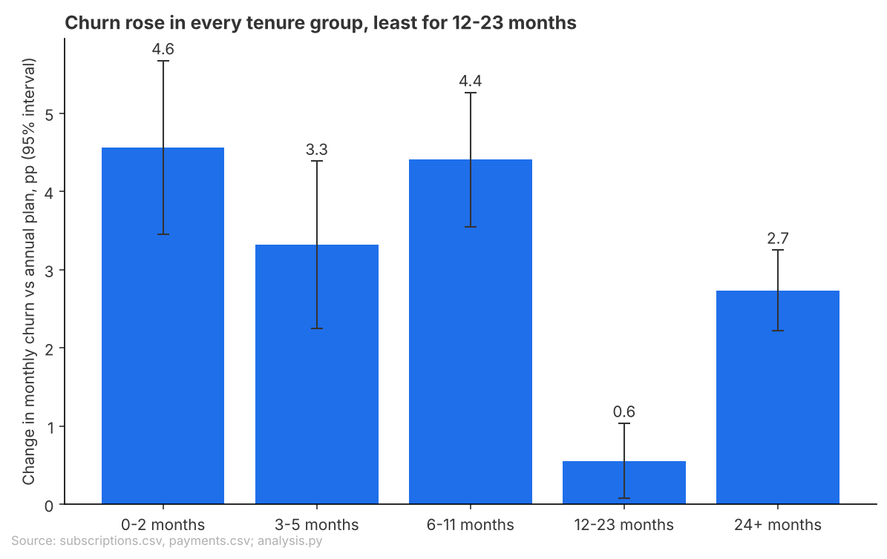
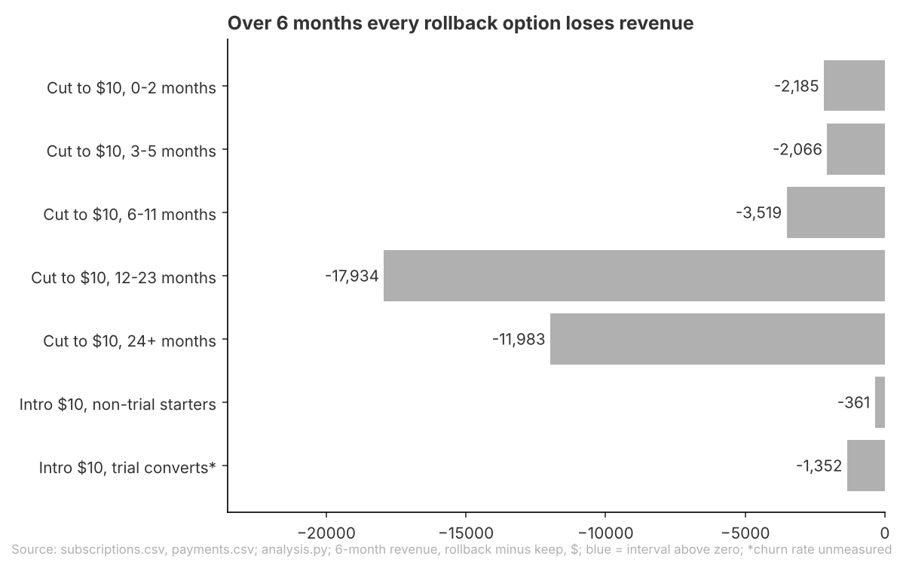
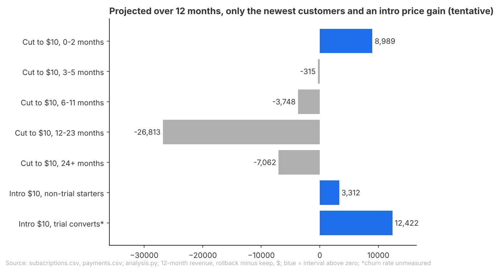

# Brief: Keep the $12 monthly price, test an intro offer

## Question
Should we roll back part of the March 2026 monthly price rise ($10 to $12) for some customers, and if so for whom?

## Recommendation
**Keep $12 for every monthly customer for now; do not roll back for any group.**
Monthly customers did leave more often after the rise, but the extra $2 from those who stay outweighs what the leavers cost: cutting back to $10 for all monthly customers would give up about $38,000 over the next six months, and no single tenure group clearly comes out ahead over that period.
Fairly confident: the six-month answer holds under every variant tested, though the data cannot fully separate the price rise from the time of year.
What would change this: if newer customers keep leaving at the post-rise rate for a full year, a $10 introductory price for new monthly starters would likely pay over twelve months; find out with a holdout test (offer $10 for the first three months to a random half of new monthly starters for one quarter, and compare revenue per starter at twelve months).

**Open for you**
- Are you willing to run a price test that may cost a little in its first six months for a likely but unproven gain by month twelve, given the billing work and possible fairness complaints a two-price setup brings?
- Did anything else change for monthly customers in spring 2026 (product, billing, marketing) that could explain part of the rise in cancellations from April?

## Key Takeaways
- Monthly churn (the share of monthly subscribers who cancel in a month) rose from 2.4% before the rise to 5.0% after, while annual-plan churn, which the rise did not touch, stayed flat.
- Over six months, every way of rolling back brings in less than keeping $12; the biggest loss would come from customers at 12-23 months, about $18,000.
- Only the newest customers might be worth a lower price, and only on a twelve-month projection: an intro price for new starters gains about $3,000 to $8,000 a year at recent sign-up volumes, so it is worth a test, not a rollout.

## Findings
### Churn rose after the price rise for every tenure group, least for customers at 12-23 months

- Against the annual plan as a yardstick, monthly churn rose by an extra **2.7 percentage points** a month overall; customers in their first year rose most, by up to 4.6 points, so the rise is broad and churn alone does not single out a group to protect.
- For customers at 12-23 months the two ways of counting leavers disagree (cancellations up 0.6 points, but the share who stop paying fell), so their rise is not clear.
- Limits: before and after cover different seasons, and the same months a year earlier showed no rise, but that check sits before a change in how cancellations are recorded, so season is not fully ruled out. Customers who switched to annual or free cannot be seen and count as leavers, which overstates churn.

### No rollback clearly pays within six months

- Cutting back to $10 for all monthly customers gives up about **$38,000** over six months against keeping $12; customers who have stayed a year or more carry most of that loss.
- After correcting for the model slightly overcounting months paid at $12, a cut for the newest customers and an intro price for new starters come out close to break-even (less than $1,000 either way), still with no clear gain.

### Over twelve months, only a lower price for the newest customers might pay (tentative)

- A $10 intro price for the first three months for new monthly starters who did not come through a free trial gains about **$3,000** a year at August's pace of new starters, rising to about $8,000 at September's pace; a cut for current customers in their first three months who did not come through a trial projects about $4,000.
- Limits: this is a projection past the data, built on about four months of post-rise churn, and churn among customers who joined at $10 eased in July (from 5.4% in June to 4.3%). The churn rate used for new starters was measured before free trials launched in August, which changed who signs up without a trial. Trial converts have no churn history yet, so their projected gain is not counted here.

## Appendix
### How this was done
- Data: Beam subscriptions, payments and trials exports, read as of 2026-09-24 (the end of the data). Free plans are left out because they never end; scheduled cancellations after 2026-09-24 count as still active.
- Population: paid monthly subscribers, split by tenure (months since start: 0-2, 3-5, 6-11, 12-23, 24+), with annual subscribers as the comparison group.
- Windows: before is October 2025 to February 2026 (starts after the October 2025 change in how end dates are recorded); after is March to July 2026, with April to July as a check. August and September 2026 are left out of compared windows because end dates in those months are recorded differently and September is incomplete.
- Measure and comparison: monthly churn per tenure group, after against before, minus the annual plan's change at the same tenure (difference in differences), with 95% intervals. A second measure, the share of payers who do not pay again the next month, is used as a cross-check that does not rely on end dates.
- Money: for the 5,560 monthly paying subscribers on 2026-09-24, projected revenue at $10 (pre-rise churn plus the annual plan's change) against $12 (post-rise churn), over six and twelve months, with bootstrap intervals. An intro price (first three months at $10, then $12) is sized for new starters at August 2026 volume and scaled to each complete month's volume from March to August. The frame's rule: roll back only where churn clearly rose and the six-month revenue gain is above zero.

### Sources
- Churn rose after the price rise for every tenure group, least for customers at 12-23 months: data/did_monthly_vs_annual_by_tenure.csv, data/churn_before_after_by_plan_tenure.csv, data/churn_monthly_by_plan.csv, data/payment_stop_rate_by_period.csv, data/seasonality_year_earlier_did.csv, data/robustness_did.csv, data/did_after_window_apr_jul.csv; analysis.py (monthly churn panel and difference in differences, lines 96-174; payments-based retention, lines 176-209; seasonality and robustness, lines 211-225).
- No rollback clearly pays within six months: data/money_rollback_by_tenure.csv, data/decision_rule_by_tenure.csv, data/money_model_vs_paid_by_tenure.csv; analysis.py (money, lines 227-413; decision rule, lines 457-491).
- Over twelve months, only a lower price for the newest customers might pay: data/decision_rule_by_tenure.csv, data/intro_price_by_starter_volume.csv, data/churn_by_month_joined_at_10.csv; analysis.py (intro range, lines 415-440; churn of $10 joiners, lines 450-455; decision rule, lines 457-491).
- Charts: analysis.py (charts, lines 494-533).

### Checks
- Checked: rerun of analysis.py matches all 18 result files; the payments join keeps 100,914 of 100,914 rows without duplicates; tenure groups sum to the 136,057 at-risk months; money by group sums to the totals in every variant; the six-month answer (no group clearly pays) holds with April to July as the after window, without September 2025 starters in the baseline, and with the keep side corrected to months actually paid.
- Not checked: the twelve-month projection beyond the data (about four months of post-rise churn, easing in July); trial converts' churn beyond their first month (trials began 2026-08-01); why non-trial and annual starts jumped in July 2026; the cost of running a targeted price (billing work, fairness complaints), which is not in the data, so the test's net value is not sized; uncertainty in the keep-side correction itself (its interval is shifted, not redrawn, and the intro volume range has no corrected interval); the model's months paid for 6-11 month customers are 5.5% off actual payments.
- Out of scope: plan switches (monthly to annual, paid to free) cannot be seen in the data and count as churn; groups other than plan and tenure, which the business cannot target; free users; new-signup volume except in the intro price sizing.
- Review findings: C1 Note (six-month chart title says every option "loses revenue"): handled by saying "no rollback clearly pays within six months" and noting the near break-even rows after correction.
- Review findings: A1 Note (trial-convert rows marked as passing at twelve months with an unmeasured rate): handled; the twelve-month case rests on non-trial starters and current non-trial customers only, trial converts are named as unmeasured and not counted.
- Review findings: A2 Small fix (intro volume range uses pre-trial-launch months and a churn rate measured on that group): handled by basing the forward range on August and September volume ($3,000 to $8,000 a year) and stating that the new-starter churn rate comes from pre-launch starters; the March to July volumes (up to 491 a month) are not used in the body.
- Review findings: A3 Note (no group passes the six-month rule; twelve-month passes are tentative; $10 joiner churn eased in July): handled by leading with the six-month answer and presenting the newest-customer options as a tentative projection worth a test.
- Review findings: A4 Note (form of a tenure rollback not set by the frame): both forms, a cut for current customers and an intro price for new starters, are sized side by side in the Findings.
- Review findings: A5 Note (12-23 month churn measures disagree): stated in the first finding; the 12-23 month rise is not called clear.
- Review findings: A6 Note (season not ruled out): stated as a limit in the first finding and in the Recommendation's confidence line.
- Review findings: A7 Note (plan switches count as churn): stated as a limit in the first finding and under Out of scope.
