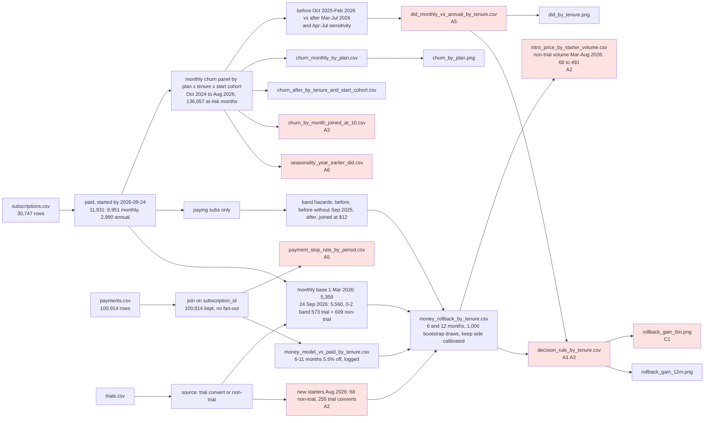

# Review: March 2026 price increase and monthly retention (fourth recheck)

## Verdict
**Ship it**: the intro volume range (earlier A2) is in and the rerun matches all 18 files; volume changes the size of the intro rows, never their sign, so no rollback clearly pays over six months and the twelve-month passes stay tentative.

## Data flow

## Code review
- **C1 Note** The six-month chart title says every rollback option "loses revenue", which holds for the uncalibrated gains it plots, but with the keep side calibrated the 0-2 month cut is about break-even and both intro rows sit just above zero, all with intervals spanning zero. Where: analysis.py:500, rollback_gain_6m.png. Fix: in the brief say "none clearly pays over six months" rather than "every option loses".

## Analysis review
- **A1 Note** (earlier A1, mostly fixed) The trial-convert rows are labelled "rate unmeasured" but still carry `rollback_recommended` True at twelve months and give the largest projected gain, while early evidence suggests trial converts churn less than non-trial $12 starters, which would shrink a rollback's gain. The non-trial rows pass at twelve months on their own, so the call does not rest on them. Where: decision_rule_by_tenure.csv, money_rollback_by_tenure.csv. Fix: in the brief, base any twelve-month case on the non-trial rows and show trial-convert rows as unmeasured, not as support.
- **A2 Small fix** (earlier A2, changed) The intro range now scales over March to August volumes, but the non-trial group changed when trials launched on 2026-08-01: non-trial starts fell from about 200 a month to 68 in August and 126 in the first 24 days of September, and their median days from signup to start dropped from about 47 to 12-21, so the Mar-Jul volumes (and the median of 197) describe a group that no longer exists, and the $12 churn rate applied to the intro rows was measured on it too. Where: intro_price_by_starter_volume.csv, analysis.py:418. Fix: mark the months before trials launched as pre-launch in the range (or base the forward range on August and September volume), and say in the brief that the intro rows' churn rate comes from pre-launch starters.
- **A3 Note** (earlier A3, unchanged in substance) No row passes the frame's six-month rule under any variant (main, Apr-Jul, without September 2025 starters, keep side calibrated); every pass is twelve-month only and flagged tentative; churn among $10 joiners eased in July, so the projected rate may not hold. Where: decision_rule_by_tenure.csv, churn_by_month_joined_at_10.csv. Fix: lead the brief with the six-month answer and present the newest-customer and intro options as a tentative twelve-month projection worth a test, not a rollout.
- **A4 Note** (earlier A4, unchanged) The frame does not name the form of a tenure rollback; both forms (price cut for the current base, intro price for new starters) are sized side by side. Where: frame.md, money_rollback_by_tenure.csv. Fix: lay out both options in the brief.
- **A5 Note** (earlier A5, unchanged) For 12-23 months the two churn measures point different ways (end-date churn up slightly, stopping payment down), and part (a) of the rule passes for every band, so only the money separates groups. Where: payment_stop_rate_by_period.csv, did_monthly_vs_annual_by_tenure.csv. Fix: give the brief the range from both measures and do not call the 12-23 rise clear.
- **A6 Note** (earlier A6, unchanged) Season is not ruled out: before and after are different seasons and the same-months check sits before the October 2025 end-date step. Where: seasonality_year_earlier_did.csv. Fix: say so in the brief's limits.
- **A7 Note** (earlier A7, unchanged) Plan switches cannot be seen and count as churn. Where: frame.md. Fix: keep it in the brief's limits.

## Checked
- Earlier findings: A2 changed (range added; now Small fix on which months stand for the future group); C1 and A1, A3-A7 still open as notes, unchanged by this round, since the only code change is the new range table and its print.
- Rerun: copy with the root path moved up one level, exit clean, all 18 result files match; writes only inside its folder, prints aggregates only; join does not fan out; bands sum to totals; 6-11 month model check still off by 5.5% and logged. The range scales the intro gain, its interval and the calibrated gain linearly with volume, which holds because the intro rows are linear in starters.
- Dates and windows: analysis date 2026-09-24 throughout; before Oct 2025-Feb 2026, after Mar-Jul 2026 with Apr-Jul as a sensitivity; August and partial September out of every compared window; the volume range uses complete months only (March to August 2026).
- Source data (Act 6): earlier checks stand (end-time and last-payment-gap steps are mix and behaviour, not recording). New: non-trial monthly starts by month against source, country, device and signup-to-start lag. Country and device mix stay steady; the July jump (491, with annual starts also doubling) and the August fall come with the trial launch and a shorter signup-to-start lag, so the forward non-trial group differs from the measured one (A2).
- Charts: chart code and all four charts unchanged since the last review; earlier chart checks stand (C1 on the six-month title wording).

## Not checked
- Twelve-month projection beyond the data: not testable; the after rate has about four months behind it and eased in July.
- Trial converts' churn beyond their first month: they only start from August 2026.
- Why non-trial and annual starts jumped in July 2026: the data shows the timing next to the trial launch but not the cause.
- The cost of running a targeted price (billing work, fairness complaints): not in the data.
- Uncertainty in the calibration factor itself: the calibrated interval is the bootstrap interval shifted, not redrawn; the range table carries no calibrated interval at all.
- brief.md was written before the range table existed; it was not reread, since deliver rebuilds it.
- Nothing was written to `knowledge/beam/` by this run, so there was nothing to reconcile.
