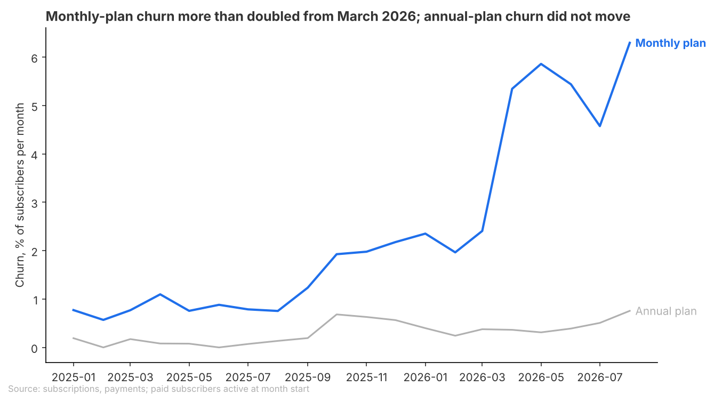
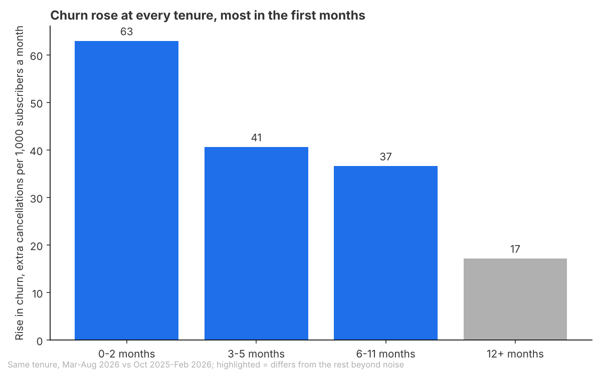
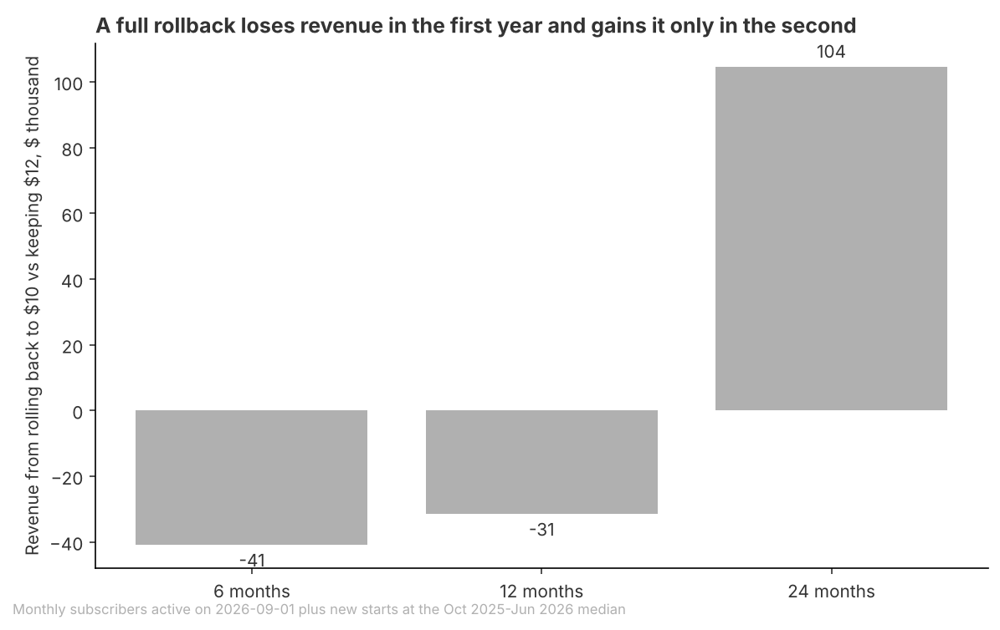

# Brief: March 2026 price increase and retention

## Question
Should Beam roll back part of the March 2026 monthly price increase ($10 to $12) for some customers, given what it did to retention?

## Recommendation
**Do not roll back now; keep $12 for the existing base, and if Beam can price new subscribers separately, make any partial rollback a lower price for new subscribers in their first months.**
Monthly churn more than doubled after the increase and has not faded, but keeping $12 still brings in about $31,000 more over the next 12 months across all monthly subscribers than a full rollback would.
How sure: tentative. The rise in churn is clear, but the money case rests on a projection that turns the other way in the second year if churn stays this high, and we do not know which customer groups Beam can price separately.
What would change this: if churn is still more than double its old level in early 2027, a rollback starts to pay in its second year, first for new subscribers, and should be made.

**Open for you**
- Which groups can Beam actually charge differently: new against existing subscribers, region, or device? A lower price for new subscribers in their first months needs a new-against-existing (or introductory) price; the data cannot tell us whether that lever exists.
- Did anything change in October 2025 (cancellation logging, billing, the product)? Churn on both plans roughly doubled then, before any price change; it does not affect the comparison above, but it is unexplained.

## Key Takeaways
- Monthly-plan churn (the share of monthly subscribers who leave in a month) rose from 2.1% to 5.0% a month after the increase, while churn on the annual plan, whose price did not change, held steady.
- The rise is largest early in a subscription: churn in the first three months went from 2.4% to 8.7% a month, while subscribers of a year or more reacted least and region and device differ much less.
- So far the increase has paid: over March to August 2026 it brought in about $47,000 more than it lost to extra cancellations, but if churn stays at its new level a full rollback would earn more from the second year on.

## Findings
### Monthly churn more than doubled after the increase, and the annual plan did not move

- Compared with subscribers at the same stage of their subscription, churn rose 3.3 percentage points (from 2.1% to 5.3% a month, 156% relative); the annual plan, a comparison group with no price change, fell slightly.
- The reaction has held: five months on, existing subscribers still leave at 2.4 times the old rate for their tenure, against 2.6 times in April and May.
- Limit: the before period (October 2025 to February 2026) is a different season from the after period (March to August 2026). A same-season comparison with 2025 is not like for like because cancellations were recorded differently before October 2025. The flat annual plan argues against a seasonal cause but does not rule it out.

### The rise is concentrated in the first months of a subscription

- New subscribers who joined at $12 leave at 10.1% a month against 2.5% for subscribers at the same stage before the increase; long-standing subscribers reacted least.
- US and iOS subscribers rose less than the rest and Web subscribers more, but these gaps are small next to the gap by tenure; no region or device stands out enough to target on its own.
- Limit: the group of new subscribers is changing. Since August 2026 most new monthly subscribers come from the new free trials, and July 2026 brought 491 new monthly subscribers against 197 in a usual month, from no known source, so the new-subscriber result may not carry over to them.

### A rollback loses money over the next year and pays only in the second

- For all monthly subscribers (5,352 on 1 September 2026, plus new ones at the usual rate), keeping $12 brings in about $31,000 more over 12 months than a full rollback, but about $104,000 less over 24 months if churn stays at its new level.
- Over 12 months a rollback for the existing base loses about $32,000, while for new subscribers it roughly breaks even ($0) and gains about $55,000 over 24 months, which is why any partial rollback should start with new subscribers.
- Limit: the projection assumes churn stays where it has been since April 2026 and that new subscribers keep arriving at the October 2025 to June 2026 rate; the 24-month figure is a projection beyond what has been observed.

## Appendix
### How this was done
- Data: Beam subscriptions, payments, users and trials exports, as of 2026-09-24 (treated as today).
- Population: paying monthly subscribers (free plans excluded; 582 scheduled starts after 2026-09-24 and 276 subscriptions that never paid excluded, 235 of them from the September 2025 sign-up spike). Annual subscribers used as a comparison group.
- Measure: monthly churn, the share of subscribers active at the start of a calendar month whose subscription ends in that month, counted on dates.
- Comparison: after-period March to August 2026 (closed months; September 2026 is partial) against October 2025 to February 2026, the months recorded the same way. Also at the same tenure (after-period rates reweighted to the before-period mix of tenure), without the September 2025 cohort, and against March to August 2025 as a sensitivity.
- Groups: tenure (0 to 2, 3 to 5, 6 to 11, 12 or more months), start cohort (existing against new since March 2026), region and device. Payment method was dropped: subscribers switch methods between payments, so it is not a customer attribute.
- Money: observed March to August 2026 (extra $2 on every payment at $12, against months of $10 lost to extra cancellations at the same tenure), and a tenure-aware projection over 6, 12 and 24 months from 1 September 2026 of keeping $12 with after-period churn against rolling back to $10 with before-period churn.

### Sources
- Monthly churn more than doubled after the increase, and the annual plan did not move: data/headline_churn.csv, data/churn_by_month.csv, data/existing_churn_by_month_since_change.csv, analysis.py (sections 5 and 6).
- The rise is concentrated in the first months of a subscription: data/segments_churn_change.csv, data/monthly_churn_by_tenure.csv, data/new_monthly_starts_mix.csv, analysis.py (sections 7 and 9).
- A rollback loses money over the next year and pays only in the second: data/money_projection.csv, data/money_observed_mar_aug_2026.csv, data/break_even_churn_rise.csv, analysis.py (section 8).

### Checks
- Checked: rerun from a copy reproduces all 16 result files; joins do not fan out; segment counts and churners add back to the total; the baseline is wholly after the October 2025 change in how end dates are recorded, and the April 2026 shift in end-date format follows the mix of start cohorts, not a logging change; all compared months are closed by 2026-09-24.
- Checked: same-tenure rise holds without the September 2025 cohort (2.8 percentage points raw, against 2.9 with it); new subscribers who left in their start month, which the monthly rates do not count, were 20 of 1,601 after the increase and 4 of 859 before.
- Checked: over 12 months, keeping $12 loses revenue only if churn rises by more than 3.7 percentage points a month at every tenure; the observed same-tenure rise is 3.3.
- Not checked: cancellations against failed payments (the status field changes how it is recorded in August 2026 and cannot separate them); downgrades to the free plan (each user has one subscription); whether something other than the price changed in March 2026 (the user knows of none). Group intervals treat each subscriber-month as independent and are somewhat too narrow.
- Out of scope: free plans; trial conversion as an outcome; setting a new price level.
- Review findings: C1 Note: fixed in round 2, rerun matches. A1 Needs the user: which groups can be priced separately, under Open for you. A2 Needs the user: the October 2025 rise in churn, under Open for you; the baseline sits after it. A3 Small fix: chart title corrected to "only breaks even on new starts" and the script rerun. A4 Note: changing make-up of new subscribers, stated as a limit on the second finding. A5 Note: season, stated as a limit on the first finding. A6 Note: projection persistence, reflected in "tentative" and the limit on the third finding. A7 Note: intervals somewhat narrow, under Not checked.
