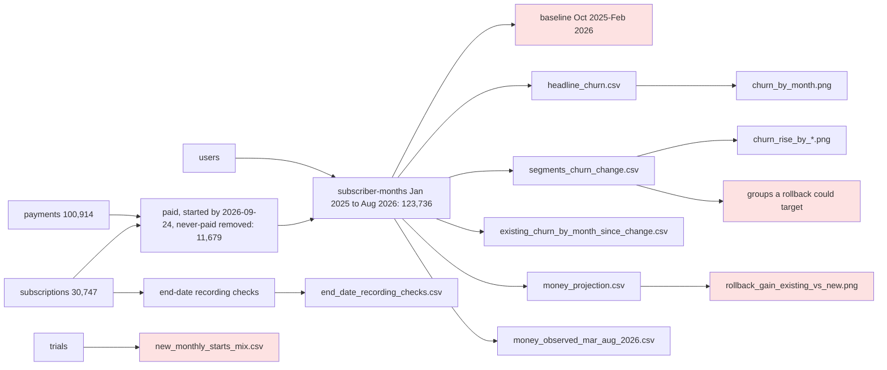

# Review: March 2026 price increase and retention

## Verdict
**Think on it**: the numbers rerun exactly and the baseline sits on one side of the end-date recording change, but two questions only the user can answer remain (which groups Beam can price separately, and what doubled churn in October 2025), and one chart title overstates its result.

## Data flow

Tags: B = A2; L = A1; rollback_gain_existing_vs_new.png = A3; new_monthly_starts_mix.csv = A4.

## Code review
- **C1 Note** Fixed since round 1: the script now finds the repo root from the working directory, and a copy in `rerun/` reproduces all 16 result files exactly. Where: analysis.py:14.

## Analysis review
- **A1 Needs the user** Which groups Beam can price separately is not known, so it cannot be said whether the groups that stand out (subscribers in their first months and new subscribers who joined at $12, with a larger rise than the rest; US and iOS with a smaller one) can be targeted. Where: frame.md Population, segments_churn_change.csv. Fix: ask the user which of new against existing, region and device Beam can charge separately; the brief names the lever each option needs.
- **A2 Needs the user** Monthly churn roughly doubled in October 2025, before any price change, even in a steady cohort (subscribers who started before June 2025), and annual-plan churn stepped up at the same point; this coincides with the change in how end dates are recorded. The baseline (October 2025 to February 2026) sits wholly after that change, so the before-and-after comparison is like for like, but the earlier, lower level cannot be used and the cause is unknown. Where: churn_by_month.csv, frame.md Analysis window. Fix: ask the user what changed in October 2025 (cancellation logging, billing, a product change).
- **A3 Small fix** The chart title "a rollback ... pays back on new starts" overstates the result: over 12 months a rollback for new starts is close to zero (it pays back only at 24 months). Where: analysis.py:524, rollback_gain_existing_vs_new.png. Fix: retitle to what the bars show.
- **A4 Note** The group a rollback for new subscribers would act on is changing: from August 2026 most new monthly starts come from trials, and July 2026 starts were about two and a half times the usual month with no known source. The new-subscriber churn rise was measured on March to July starts, so it may not hold for trial-fed subscribers. Where: new_monthly_starts_mix.csv. Fix: carry as a limit on any new-subscriber claim.
- **A5 Note** The baseline (October to February) and the after-period (March to August) are different seasons; the same-season 2025 baseline is on the other side of the recording change and shows a larger rise. The annual plan, whose price did not change, is flat across the same two periods, which argues against a seasonal cause, but season is not ruled out. Where: headline_churn.csv. Fix: none in the data; carry as a limit.
- **A6 Note** The projection assumes after-period churn persists; it is steady over the five months observed (2.6 times baseline at the same tenure in April and May, 2.4 times in July and August), and the answer flips sign between 12 and 24 months, so any recommendation resting on the 24-month figure can only be tentative. The observed six months (net gain from the increase) are shown next to it. Where: money_projection.csv, existing_churn_by_month_since_change.csv.
- **A7 Note** Group intervals treat subscriber-months as independent though the same subscribers recur month to month, so they are somewhat too narrow; the groups flagged by tenure and new-versus-existing are far beyond noise, the region and device differences less so. Where: segments_churn_change.csv.

## Checked
- Recheck of round 1: C1 fixed (rerun matches, 16 of 16 files); A1 fixed (the April 2026 step in end-date format and timing is absent in steady cohorts: time of day follows the start cohort, so it is mix, not a recording break); A2 fixed (trend now from April, on churn relative to baseline at the same tenure: steady); A3 fixed (ends in the start month shown separately, 20 of 1,601 starts after against 4 of 859 before); A4 still open (now A1).
- Dates and windows: analysis date 2026-09-24 used; after-period March to August 2026 and baseline October 2025 to February 2026 are closed months; September 2026 excluded as partial; baseline is wholly after the October 2025 end-date recording change.
- Source data (Act 6): payment amount steps from $10 to $12 in March 2026 (the price change itself); the time-of-day and payment-to-end gap steps are mix, not recording, in steady subsets; `status` switches from all "expired" to all "canceled" in August 2026 (a recording break, but the analysis does not use status); the plan mix of new paid starts is stable.
- Fit to frame: decision, audience and money side covered; money sized for the whole monthly base over the six observed months and 6, 12 and 24 months ahead; annual plan used as a comparison group; tenure and start cohort splits as corrections.md asks.
- Charts opened: titles match their results except A3; axes start at zero.

## Not checked
- Whether customers left because of the price rather than another change in March 2026: the user knows of no other change, and the annual plan is flat, but nothing in the data tests it directly.
- Lost new sign-ups or downgrades to free caused by the price: new monthly starts did not fall (new_monthly_starts_mix.csv), but plan switches cannot be seen because each user has one subscription.
- Cancellations against failed payments: `status` cannot tell them apart.
