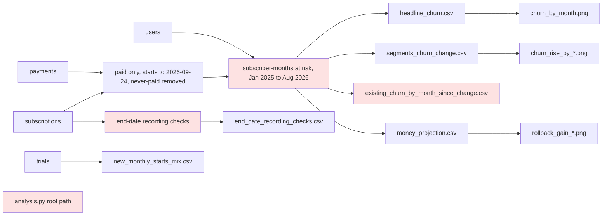

# Review: March 2026 price increase and retention

## Verdict
**Fix first**: the script cannot be rerun from a copy, so none of its numbers could be reproduced, and its own recording check flags a step inside the compared window that the analysis leaves unexplained.

## Data flow

Tags: R0 = C1; F3 = A1; R3 = A2; F2 = A3.

## Code review
- **C1 Small fix** The rerun copy fails with "No module named helpers": the script finds the repo root as two folders above its own file, so a copy in `rerun/` looks for `data/` and `helpers/` in the wrong place. Where: analysis.py:14. Fix: resolve the repo root from the working directory (the script is run from the repo root) or by searching upward for `data/`, so a copy runs and writes into its own folder.

## Analysis review
- **A1 Small fix** The script's own `stable_over_time` check finds the share of end dates with a time of day stepping from 32% to 48%, and the median days from last payment to end stepping from 20 to 15, in April 2026, inside the compared window; the analysis prints this and moves on, without testing whether it is a recording change or behaviour (cancelling sooner after the first $12 charge). Where: analysis.py section 3, end_date_recording_checks.csv. Fix: rerun the check on a subset with a steady mix (for example existing subscribers at 12+ months, or the baseline-period cohorts) and save the result; say which it is.
- **A2 Small fix** The "steady" label for churn since the change compares March to May with June to August, but March is a transition month (most March cancellations were set before the first $12 charge), which drags the early average down and can hide a fading reaction. Where: analysis.py:246-248, existing_churn_by_month_since_change.csv. Fix: label the trend from April onward, and keep the month-by-month table.
- **A3 Small fix** A subscription counts as at risk only from the first full month after it starts, so new subscribers who cancel inside their first calendar month are never counted; this understates churn for the new-subscriber group the recommendation may act on. Where: analysis.py:134. Fix: count the start month as at risk for subscriptions that start in it (or show the share lost before their first full month, by period), and say which.
- **A4 Needs the user** The frame does not say which groups Beam can price differently; the analysis singles out new against existing subscribers, tenure, region and device, and none is known to be a lever. Where: frame.md Population. Fix: ask the user which of these Beam can charge separately; until then the brief names the lever any recommendation needs.

## Checked
- Fit to frame: answers retention before and after, splits by tenure and start cohort as corrections.md asks, sizes money for the whole monthly base over 6, 12 and 24 months; free plans, scheduled starts and future end dates handled as quirks.md says.
- Dates and windows: analysis date 2026-09-24 used, never the real date; after-period March to August 2026 and baseline October 2025 to February 2026 are closed months; September 2026 excluded as partial; the same-season 2025 baseline is shown only as a sensitivity, labelled as recorded differently.
- Exclusions are counted with reasons (exclusions.csv); joins checked for fan-out; segment subscriber-months and churners add back to the total.
- Source-data checks (Act 6) were not run this round, because the rerun failed (see Not checked).

## Not checked
- Rerun and comparison of results, charts, the reasoning review and the source-data checks were skipped because the rerun failed (C1), as the validate method requires.
