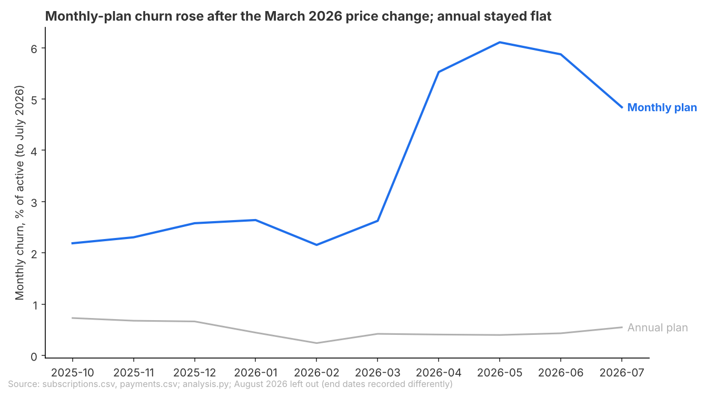
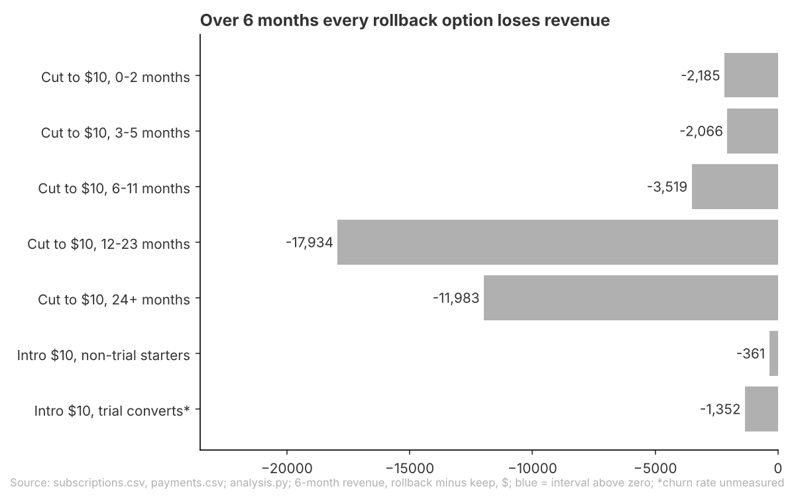

# Brief: Keep the $12 monthly price; test a $10 intro price before rolling anything back

## Question
Should we roll back part of the March 2026 monthly price rise ($10 to $12) for some customers, and if so, for which ones?

## Recommendation
**Keep $12 for every existing monthly customer, and run a small test of a $10 price for the first three months for new monthly starters who did not come through a trial.**
Rolling the price back for the whole monthly base would give up about $38,000 over the next six months, and no tenure group's rollback clearly pays for itself in that time. The only options that come out ahead do so in a twelve-month projection, the intro price by about $3,000 a year.
Fairly confident on not rolling back: it holds under every baseline, time window and model correction tried. Tentative on the intro price: its gain rests on a projection beyond the data, and churn was already easing in July.
What would change this: if the test shows $10 starters cancelling clearly less than $12 starters by month three, extend the intro price; if churn keeps easing back toward its old level, the case for any rollback weakens further.

**Open for you**
- Did anything else change for monthly customers between March and July 2026 (product, content, marketing, a competitor's move) that could explain part of the churn rise?
- Is a price that differs by customer group acceptable to run, given billing work and the risk of fairness complaints? The data cannot size that cost.

## Key Takeaways
- Monthly churn (the share of monthly subscribers who cancel in a month) roughly doubled after the price rise, from 2.4% to 5.0%, while the annual plan, whose price did not change, stayed flat.
- Churn rose in every tenure group (how long a customer has subscribed), most for the newest customers and least for those 12 to 23 months in.
- Even so, cutting back to $10 loses money for every group over six months, about $38,000 for the whole base; only the newest customers and an intro price for new starters come out ahead, and only in a tentative twelve-month projection.

## Findings
### Monthly churn about doubled after the price rise; annual churn did not move

- The rise lines up with the price change and did not happen on the annual plan, so the price rise very likely cost customers.
- Limit: the before months (October to February) and after months (March to July) are different seasons. The same months a year earlier showed no rise, but end dates were recorded differently then, so season is not fully ruled out.
- Limit: a customer who moved from monthly to annual or to free cannot be told apart from one who cancelled, so some of this "churn" may be customers who stayed.

### Churn rose in every tenure group, least for customers 12 to 23 months in

- The rise beyond the annual plan's change was largest for customers in their first two months (**4.6 points**, percentage points of monthly churn) and smallest for those 12 to 23 months in (0.6 points).
- Limit: for the 12 to 23 month group, payment records point the other way: the share who stopped paying the next month fell from 3.1% to 1.8%. Their rise is not clear.
- Limit: among customers who joined at $10, monthly churn peaked at 5.9% in May and eased to 4.3% in July, so the extra churn may be fading.

### No rollback clearly pays over six months; only the newest customers and an intro price gain over twelve

- Over six months the largest losses come from cutting the price for long-standing customers: about $18,000 for 12 to 23 months and $12,000 for 24 months and more. After correcting the model against months actually paid, the newest-customer cut and the intro price come out about even, still not clearly ahead.
- Over a projected twelve months, a $10 price for non-trial customers in their first two months gains about $4,000 and a $10 intro price for non-trial new starters about $3,000. That is what the test should confirm.
- Limit: customers who came through a trial only exist from August 2026, so their churn at $12 is not measured; they are not counted as support for the intro price. The intro money is sized on one month of new starters, and monthly volumes have swung widely; volume changes the size of the gain, not whether it is a gain.

## Appendix
### How this was done
- Data: Beam subscriptions, payments and trials exports, read as of 2026-09-24 (the end of the data).
- Population: paid subscriptions (free plans excluded, since they never end).
- Measure: monthly churn, the share of paid subscriptions active at the start of a month that end during it, split by plan and by tenure at the start of the month (0-2, 3-5, 6-11, 12-23, 24+ months).
- Window: before is October 2025 to February 2026 (after the October 2025 change in how end dates are recorded); after is March to July 2026, with April to July as a sensitivity. August 2026 is shown on its own (end dates recorded differently) and September 2026 is open.
- Comparison: difference-in-differences, each monthly tenure group's change in churn minus the annual plan's change over the same months, with 95% intervals.
- Second measure: share of monthly payers in a month who do not pay the next month, from payments alone.
- Money: revenue at $10 with baseline churn plus the annual trend, against revenue at $12 with the churn seen after the change, over 6 and 12 months, for two forms: a price cut for the monthly base on 2026-09-24 by tenure, and a $10 intro price for the first three months for new starters. 1,000 bootstrap draws for intervals; the $12 side calibrated against months actually paid.
- Decision rule (from the frame): a group qualifies only if its churn rose clearly beyond the annual plan's change and a rollback's revenue beats keeping $12 over six months.

### Sources
- Monthly churn about doubled after the price rise; annual churn did not move: data/churn_monthly_by_plan.csv, data/churn_before_after_by_plan_tenure.csv, data/did_monthly_vs_annual_by_tenure.csv, data/seasonality_year_earlier_did.csv, analysis.py (monthly churn panel, lines 96-160; seasonality, lines 211-214; chart, lines 468-472)
- Churn rose in every tenure group, least for customers 12 to 23 months in: data/did_monthly_vs_annual_by_tenure.csv, data/payment_stop_rate_by_period.csv, data/churn_by_month_joined_at_10.csv, data/robustness_did.csv, data/did_after_window_apr_jul.csv, analysis.py (DiD, lines 135-160; payments, lines 176-209; robustness, lines 216-223; joined at $10 by month, lines 423-428; chart, lines 473-486)
- No rollback clearly pays over six months; only the newest customers and an intro price gain over twelve: data/decision_rule_by_tenure.csv, data/money_rollback_by_tenure.csv, data/money_model_vs_paid_by_tenure.csv, analysis.py (money, lines 227-413; decision rule, lines 430-464; charts, lines 487-506)
- Recommendation and takeaways: $38,000 is the six-month "All tenures" row for the 2026-09-24 base; $3,000 and $4,000 are the twelve-month intro non-trial and 0-2 month non-trial rows in data/decision_rule_by_tenure.csv; 2.4% and 5.0% are the monthly "All tenures" rates in data/did_monthly_vs_annual_by_tenure.csv.

### Checks
- Checked: rerun of the analysis matches all 17 result files; the payments join does not duplicate rows; tenure groups and money groups sum to their totals; the money model was checked against months actually paid (within 5% for every group except 6-11 months, where paid months were 94.8% of modelled; the $12 side was calibrated); the six-month answer (no rollback clearly pays) holds in the main run, with April to July as the after window, without September 2025 starters in the baseline, and with the $12 side calibrated; the churn rise holds without September 2025 starters and without paid subscriptions that have no payments.
- Not checked: the twelve-month projection beyond the data (about four months of after data, and churn eased in July); churn of trial converts beyond their first month (they start in August 2026); the intro money as a range over recent monthly volumes of new starters (sized on August 2026 only; the range is not in the result tables); the cost of running a targeted price (billing work, fairness complaints); why non-trial monthly starts jumped in July 2026 and fell in August; uncertainty in the calibration factor itself.
- Out of scope: groups other than plan and tenure (not targetable); free users; acquisition; plan switches (monthly to annual, paid to free), which the data cannot show and which count as churn here.
- Review findings: C1 Note, six-month chart title says every option "loses revenue": brief says none clearly pays, and notes the calibrated newest-customer and intro rows are about even.
- Review findings: A1 Note, trial-convert rows unmeasured but marked as passing at twelve months: brief bases the twelve-month case on non-trial rows only and shows trial converts as unmeasured.
- Review findings: A2 Note, intro price sized on August 2026 alone: stated in Finding 3's limit; a range over recent volumes is not in the result tables, so listed as not verified.
- Review findings: A3 Note, no row passes the six-month rule; twelve-month passes are tentative and churn among $10 joiners eased in July: recommendation leads with the six-month answer and frames the intro price as a test, not a rollout.
- Review findings: A4 Note, the form of a tenure rollback is not named in the frame: both forms (base cut by tenure, intro price) shown in Finding 3.
- Review findings: A5 Note, the two churn measures disagree for 12 to 23 months: both given in Finding 2, rise not called clear.
- Review findings: A6 Note, season not ruled out: stated in Finding 1's limit and covered by the test in the recommendation.
- Review findings: A7 Note, plan switches cannot be seen and count as churn: stated in Finding 1's limit.
