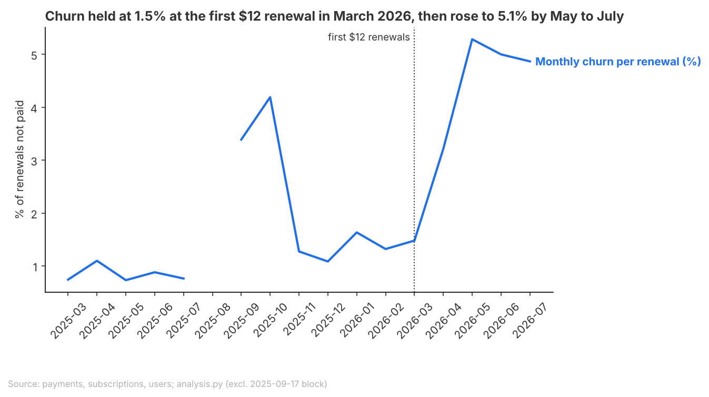
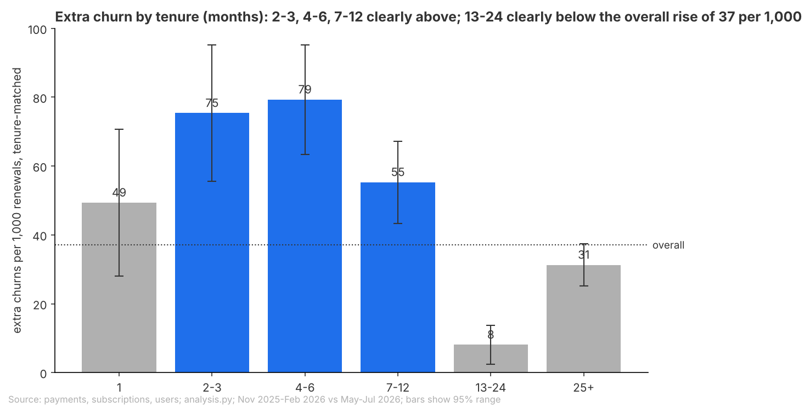
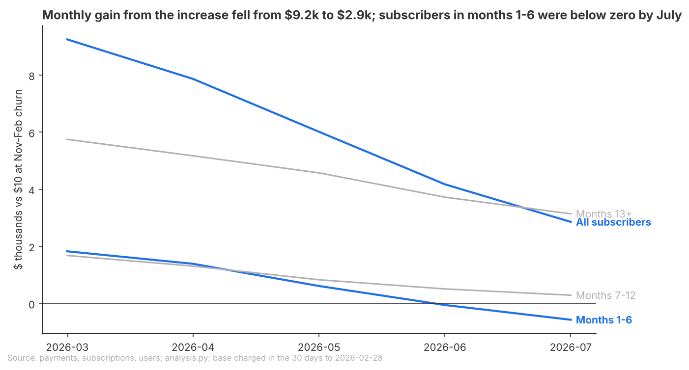

# Brief: March 2026 price increase and retention

## Question
Should we roll back part of the March 2026 monthly price increase ($10 to $12), and for which customers?

## Recommendation
**Move first-year monthly subscribers back to $10 as a two-month test on a random half of them, and keep $12 for everyone past their first year.**
Since May, cancellations outweigh the higher price: across 4,599 measured monthly subscribers, $12 projects about $7,000 less than $10 over 12 months, and the losses sit in the first year.
Tentative: that figure is not verified for season (winter against summer) and assumes $10 restores the old churn; only subscribers who joined without a trial were measured.
What would change this: if the half back at $10 cancels as often as the half at $12, price is not the cause and $12 should stay. Season cannot be checked against last year: something unexplained changed in September or October 2025 (the same weeks as a bulk sign-up of 1,385 subscriptions), so the test is the only clean check; whoever owns billing may know what changed.

**Open for you**
- Did anything else change for subscribers between March and July 2026?

## Key Takeaways
- Churn (the share of monthly renewals not paid) rose from 1.3% before the increase to 5.1% by May to July, past the point where $12 stops paying off.
- The rise is in the first year of a subscription: churn rose 7.9 points at four to six months, against 0.8 points at 13 to 24 months.
- The extra monthly cash from the increase fell from about $9,000 in March to $3,000 in July; subscribers in their first six months were below zero by July.

## Findings
### Churn almost quadrupled once $12 renewals arrived, and stayed there

- Break-even (the churn at which $12 earns what $10 did) is 4.8%; the projected 12-month result ranges from a $17,000 loss to a $4,000 gain.
- New monthly sign-ups held: about 195 a month, against 198 before.
- Limit: season is unchecked.

### The damage is in the first year of a subscription

- Every band under 12 months loses at $12; 13 to 24 months gains about $22,000. Months seven to twelve, and groups outside the US and iOS, are tentative.
- A first-year rollback reaches 1,547 measured subscribers plus 560 and 302 from two bulk sign-up days never measured; trial converters since August are not measured.

### The gain from the increase is shrinking every month

- March to July still brought about $30,000 more than $10 would have; July alone $3,000 (range $2,000 to $3,000).
- Firmest for months one to six; five observed months, against a twelve-month projection.

## Appendix
### How this was done
- Data: Beam payments, subscriptions and users. Population: paying monthly subscribers, excluding every user with a trial record (user's request), the 2025-09-17 and 2026-07-30 bulk sign-up blocks, and anything after 2026-07-31. Trial converters (from 2026-08-15) are not measured and not counted anywhere.
- Churn per renewal: a monthly charge with no charge 30 days later. Main comparison: renewals due November 2025 to February 2026 (before) against May to July 2026 (after, once churn settled), before reweighted to the same months-subscribed mix, with 95% ranges.
- Projected money: 12 months from 2026-07-31 for the 4,599 measured active subscribers (3,052 past and 1,547 in their first year), $12 at after-churn against $10 at before-churn. Break-even: the churn at which 12 months at $12 earn the same as at $10 with before-churn.
- Observed money: what the 4,572 subscribers charged 2026-01-30 to 2026-02-28 paid on renewals due March to July, against $10 at their group's before-churn, by month, with 95% ranges from the before-churn only. This base and the projected base are different people at different dates.
- New sign-ups: paid starts per month, after against November 2025 to February 2026, bulk days removed, Poisson 95% range on the ratio (change -1%, range -10% to +8%).

### Sources
- Churn almost quadrupled: data/headline_churn.csv (main, before_clean vs after_steady), data/churn_by_due_month.csv, data/money_by_segment.csv (all, breakeven_churn_at_12, gain bounds), data/new_paid_starts_by_window.csv; analysis.py (headline, lines 131-162; money, 196-259; new starts, 340-377; chart, 386-399).
- The damage is in the first year: data/churn_by_segment.csv (tenure, before_clean vs after_steady), data/money_by_segment.csv (tenure, country, device_type), data/rollback_reach_2026_07_31.csv; analysis.py (segments, lines 164-177; money, 196-259; reach, 451-466; chart, 401-425).
- The gain is shrinking: data/observed_revenue_by_due_month.csv, data/observed_revenue_mar_jul.csv, data/observed_gain_by_due_month_grouped.csv; analysis.py (observed revenue, lines 261-331; grouped table and chart, 427-449).
- Recommendation money ($7,000, 4,599 subscribers): data/money_by_segment.csv (all, before_clean vs after_steady).

### Checks
- Checked: a rerun from an unedited copy matches all 14 result files; all 17 built-in checks pass or report the known end-date recording break the script measures around; segment counts add to 4,599 in every dimension; the measured base equals the measured rows of the reach table; nothing due after 2026-07-31 is used.
- Not checked: whether returning to $10 restores before-churn (no group stayed at $10; every money figure assumes it); plan switches (not visible in the data).
- Not verified (analysis gaps, lowering confidence): season in the main comparison (winter against summer, four months against three); no result table holds the projected money for the first-year group as a whole, only per band, so the recommendation quotes the whole measured base; the grouped monthly gain table carries no range; the one-month band rests on 185 subscribers; country by device cells are thin; churn rose in April and May, a month or two after the first $12 charge.
- Out of scope: everything from 2026-08-01, all trial users and trial converters, free plans, annual subscribers as a main control (annual churn 4.8% after against 4.6% before, background only).
- Review findings: A1 Needs the user (Sep/Oct 2025 churn change, year-earlier baseline unusable): not verified; no year-earlier figure is quoted, season is stated as unchecked, confidence is tentative; the user does not know what changed (2026-11-08), so it stays unexplained and the test is named as the season check.
- Other review findings: 3 Notes (A2, A3, A4), in review.md.
