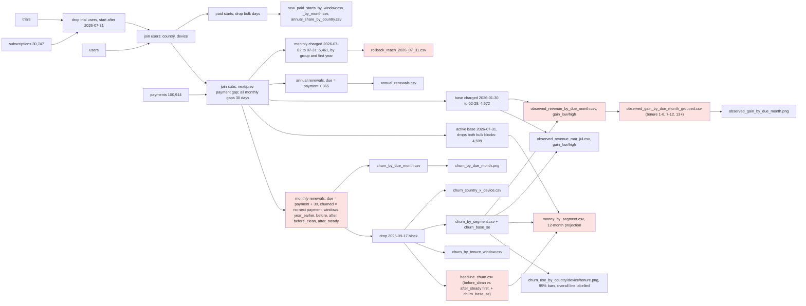

# Review: March 2026 price increase and retention (sixth recheck)

## Verdict
**Think on it**: C1 is fixed and the rerun matches, so the money tables and the reach table now describe the same measured base, but the unexplained Sep/Oct 2025 change still needs the user and leaves season unchecked in the main comparison.

## Data flow

## Code review
- No open code findings. Earlier C1 (money base kept the unmeasured 2026-07-30 block) is fixed at analysis.py:75 and analysis.py:213; see Checked.

## Analysis review
- **A1 Needs the user** Still open (unchanged): monthly subscribers who started before 2024 show no churn until Sep 2025 and about 1% a month from Oct 2025, and 2025 starters miss 7% to 14% of renewals in Sep-Oct 2025, which the data does not explain; the year-earlier baseline stays unusable and the main comparison (Nov-Feb winter against May-Jul summer) has no clean check for season. Where: subscriptions, payments; year_earlier rows of headline_churn.csv and churn_by_segment.csv. Fix: ask the user what changed in Sep/Oct 2025; until then the brief quotes no year_earlier row and says season is unchecked.
- **A2 Note** Still holds, now consistent with the money tables: a first-year rollback at 2026-07-31 would reach 2,409 monthly subscribers, of whom 862 (560 from the 2025-09-17 block, 302 from the 2026-07-30 block) were never measured; the money tables now cover the 1,547 measured first-year and 3,052 later subscribers only, and the base it acts on today also holds trial converters from 2026-08-15, which both tables rightly leave out. Where: rollback_reach_2026_07_31.csv, money_by_segment.csv, frame.md Population. Fix: the brief states the result covers the organic non-trial base only, quotes money for the measured 4,599 and the reach with the unmeasured groups named, and keeps any count with trial converters out until the user lifts the exclusion.
- **A3 Note** Unchanged: the gain chart title says months 1-6 "were below zero by July", which holds; the grouped table still carries no range and the ranges carry only the baseline churn's uncertainty, not the assumption that $10 would restore Nov-Feb churn. Where: observed_gain_by_due_month.png, observed_gain_by_due_month_grouped.csv. Fix: the brief keeps "by July", firmest for months 1 to 6, tentative for EU, India, Rest, Android, Web and tenure 7-12, and states the two horizons (5 observed months, 12 projected).
- **A4 Note** Smaller points for the brief. New: with the block removed, the tenure "1" money row rests on 185 subscribers (was 487), so its dollar figure is small and should not be read alone. Still open: bar value labels collide with the error-bar caps (tenure 2-3, 4-6, 13-24 most visibly); the country by device cells are thin (read only the US/iOS low end); one segment rate is used for the whole counterfactual path; the observed base (4,572, charged Jan 30 to Feb 28) and the projected base (4,599, charged Jul 2 to Jul 31) are different people at different dates, close in size only by chance; churn rose in April and May, a month or two after the first $12 charge; 4 baseline months against 3; annual stays a weak background check; 83 of 541 before-window churns have a recorded end on or after 2026-03-01.

## Checked
- Earlier findings: C1 fixed (money base now drops both bulk blocks, 4,599 = 3,052 + 1,547 measured in the reach table; segment counts add to 4,599 in every dimension; tenure "1" 185 = 487 minus 302); A1 still open; A2, A3 unchanged and carried; A4 carried with one new point.
- Rerun from an unedited copy in rerun/ (previous copy and money table kept in rerun/prev/ as _prev6): all 14 result files match; all 17 CHECK lines ran and passed or reported the known end_date midnight break the script measures around.
- Effect of the fix: every money figure shrinks by about 6% (overall main gain about -$6,950 against -$7,400 before, tenure "1" most); no gain, upper-bound or lower-bound value changes sign in any row, so no segment call moves. Churn tables are unaffected, since the 2026-07-30 starters have no renewal due by 2026-07-31.
- Dates and windows: analysis date 2026-09-24 and window end 2026-07-31 respected everywhere; due months only Mar to Jul 2026; edge months complete; before_clean (Nov-Feb) and after_steady (May-Jul) differ in season and length, see A1 and A4.
- Source data (Act 6): not repeated; the fix touched only which start days the money base drops, which reads start and payment dates already tested (monthly gaps stable at 30 days); earlier results stand, including the Sep/Oct 2025 change in A1.

## Not checked
- Charts: not reopened, as no chart reads the money base and all chart inputs match the rerun.
- Whether rolling back to $10 would restore Nov-Feb churn (all money tables assume it would); no group stayed at $10, so the data cannot show it.
- Plan switches, which the data cannot show (one subscription per user).
- brief.md, which predates this fix; deliver rewrites it (its "$7,000, 4,901 subscribers" figures are now stale).
