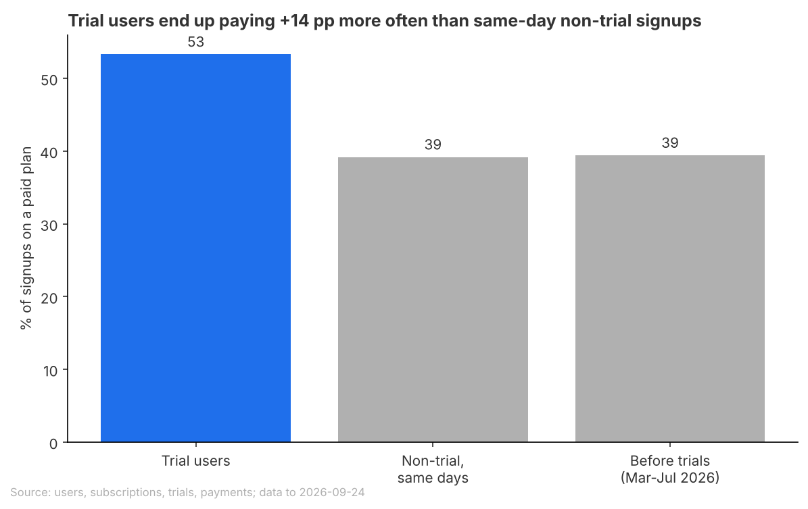
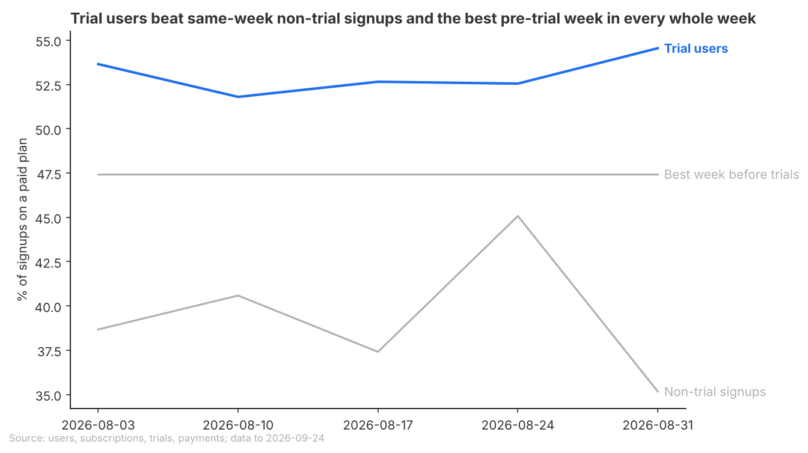

# Brief: Keep 14-day trials next quarter

## Question
Are the 14-day trials turning enough new signups into paying subscribers to keep them next quarter?

## Recommendation
**Keep 14-day trials next quarter, and hold back a random half of new signups without one as a comparison group.**
Trial users end up paying 14.1 percentage points more often than same-day signups without a trial, worth about $18,000 in extra revenue next quarter at today's signup rate.
Fairly confident: the gap holds every week and against the months before trials, but nothing records whether trials were handed out at random.
What would change this: if trial users were picked rather than drawn at random, the gap could shrink; the random split settles it at little cost.

**Open for you**
- Trials for everyone would roughly double the gain if it holds, but leave no comparison group. Which do you prefer?
- Did anything else change around 1 August (a campaign, the signup flow, how plans are recorded)? Weekly signups rose 3.5 times then.

## Key Takeaways
- 53.3% of trial users end up on a paid plan, against 39.2% of same-day signups without a trial.
- Trial users beat the best pre-trial week in all 5 whole weeks; last August ran only 1.5 points above spring, so season does not explain it.
- Trials as they run now add roughly $4,000 to $23,000 in revenue next quarter.

## Findings
### Trials lift the share of signups who end up paying by about a third

- Paid share (signups who end up on a monthly or annual plan) is 53.3% with a trial against 39.2% without, a 36% relative lift. Before trials it was 39.4%.
- Limit: the non-trial rate counts many plans not yet paid; if some never pay, the true gap is larger.

### The gap is steady week to week, and the season does not explain it

- Trial users ran 51.8% to 54.5% each week; non-trial signups never passed 45.1%. Only 5 whole weeks so far.

### Worth about $18,000 next quarter, with a wide range
**+487 extra paying subscribers next quarter, against none without trials**
- Low end ($4,000) assumes signups fall back to the spring rate; high end ($23,000) today's rate and the upper gap. The cost of running trials is not counted.

## Appendix
### How this was done
- Data: Beam users, subscriptions, trials and payments, up to 2026-09-24.
- Main test: new signups from 2026-08-01 to 2026-09-10, so that every trial had closed. That gives 1,553 trial users and 1,503 non-trial signups from the same days. The measure is the share who end up on a paid plan (monthly or annual), with a 95% interval on the gap (+10.6 to +17.6 points).
- Second baseline: signups from Mar-Jul 2026, at the same $12 monthly price, as one overall share and 21 whole weeks.
- Seasonality: Aug 2025 against Mar-Jul 2025.
- Mix and volume: country, device and plan mix by group, plus paying subscribers per week.
- Money: 13 weeks of signups times the gap, using the plan mix of trial converts, $12 monthly and $100 annual prices, and the share of monthly payers who pay a second time. Low, central and high cases, with each assumption listed in data/money_assumptions.csv.

### Sources
- Trials lift the share of signups who end up paying: data/paid_share_by_group.csv, data/lift.csv, analysis.py (Main comparison, lines 116-152)
- The gap is steady week to week: data/weekly_trial_vs_non_trial.csv, data/weekly_baseline_mar_jul_2026.csv, data/weekly_summary.csv, data/seasonality_summary.csv, analysis.py (Weekly and Seasonality, lines 159-204)
- Worth about $18,000 next quarter: data/money_next_quarter.csv (trials for about half of signups, as now: Low, Central and High), data/money_assumptions.csv, data/revenue_90d_per_payer.csv, analysis.py (Money, lines 297-357)
- Recommendation and takeaways: the same files. The "trials for everyone" option is in data/money_next_quarter.csv (Trials for all signups rows).

### Checks
- Checked: a rerun from a copy matched all 16 result files exactly. Joins do not fan out, parts add up to totals, and closed trials have no open outcome. Trial and non-trial groups are balanced on country and device (largest mix gap 1.9 points; data/mix.csv). Plan recording is level across signup months. Both charts were opened and checked against their titles.
- Not checked: whether trials were assigned at random, since only balance on recorded fields was checked. Whether plans that had not started by 2026-09-24 will be paid, since there are no payments after that date. What caused the 3.5x jump in signups on 2026-08-01: the central and high money cases use the Aug-Sep signup rate, and the low case uses the Mar-Jul rate. The cost of running trials, which no result table holds, so the money is revenue only. Retention as a warning sign: all 143 trial converts old enough paid a second time, but too few comparable non-trial starts exist (33) to compare.
- Out of scope: trial length (only 14-day trials exist) and retention past the first renewal.
- Review findings: C1 (weekly series used partial weeks): fixed before the second review, which confirmed it.
- Review findings: A1 Needs the user (subscription start dates set in batches, so 360 of 589 non-trial payers in the window hold a plan not yet started or paid): not verified. The brief states the non-trial rate counts plans not yet paid. The direction is conservative for the gap. The question of what changed on 2026-07-30 is raised under Open for you.
- Review findings: A2 Small fix (a "started only" column in paid_share_by_group.csv could be quoted as a conversion rate): applied after the review. The column was dropped, scheduled_paid was kept, and the script was rerun once. No number the recommendation rests on changed. Not re-verified by the review.
- Other review findings: 2 Notes (A3 on the money sizing assumptions, A4 on retention, balance, segments and seasonality), in review.md. Per A4, segment lifts are not ranked.
