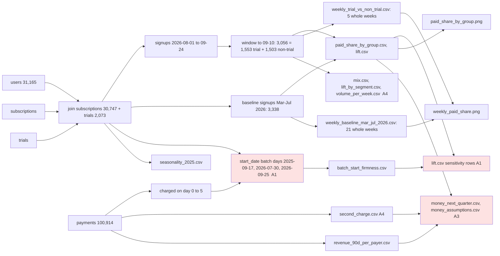

# Review: Trial conversion and the keep decision

## Verdict
**Ship it**: the trial lift (+14.1 pp against same-day non-trial signups) reruns exactly, and the two new sensitivities show it holds whether or not the not-yet-started plans pay; what remains are limits for the brief, not open questions.

## Data flow

## Code review
- No open code findings. C1 stays fixed (whole weeks only in both weekly series). The new firmness block (analysis.py:153-192) does what its comments say: it reads charges on day 0 to 5 from payments, marks the 2026-09-25 batch as not yet observable, and adds both sensitivity rows to lift.csv.

## Analysis review
- **A1 Note** Changed from Needs the user: the firmness question is now answered from the data. Paid plans on the 2026-07-30 batch were all charged at start (403 of 403), and trial converts all were (828 of 828). The lift holds if non-trial plans not yet started pay only at the worst past batch rate (+18.2 pp), and against a Mar-Jul baseline counting charged plans only (+14.1 pp). Carry into the brief: the worst past rate (83%, 2025-09-17) is the September 2025 spike's unpaid plans (quirk "Paid subscriptions without payments"), so it is a harsh floor; why start dates are batched stays unexplained but does not touch the plan field the headline uses; the "non-trial same days matches Mar-Jul" consistency (-0.2 pp) rests on those unpaid plans and should not be quoted as firm. Where: batch_start_firmness.csv, lift.csv. Fix: none needed.
- **A3 Note** Unchanged. Carry into the brief: the "trials for all signups" rows assume the no-trial half responds like those who got one, which rests on the split being random (consistent with random, not proven); the central and high cases use the Aug-Sep signup rate, whose 3.5x jump on 2026-08-01 is unexplained, and the low case uses the Mar-Jul rate; trial running costs are not counted.
- **A4 Note** Unchanged. Retention cannot serve as a warning sign (143 of 143 trial converts charged on day 30; only 33 Aug non-trial starts). Trial assignment balances on every recorded field (largest country or device gap 1.9 pp). Segment lifts rest on 270 to 640 signups each and are not tested against each other; do not rank segments. Seasonality (Aug 2025 +1.5 pp over Mar-Jul 2025) is small next to the lift.

## Checked
- Recheck: A2 fixed (the `paid_share_started_only` column is gone from paid_share_by_group.csv; the started count stays as a count next to `scheduled_paid`); A1 answered by the new results and moved to a Note; C1 and A3 stay fixed; A4 open as before.
- Rerun from a copy (repo-root path adjusted for the deeper folder) matches all 17 result files, including batch_start_firmness.csv and the new lift.csv rows, and the printed output line for line; joins do not fan out, parts sum to totals, matured trials have no open outcome.
- Dates: analysis date 2026-09-24 throughout; trial users counted once their 14-day window closed (signups to 2026-09-10), non-trial from the same days; weekly series whole weeks only; the 2026-09-25 batch is flagged as not observable rather than read as unpaid.
- Source data (Act 6): repeated only for the new measure, charged on day 0 to 5 after start, over 2025-01 to 2026-09 start months: level near 100% with no lasting step; the one dip (September 2025, 85%) is the known spike quirk and vanishes when that month is left out. Earlier checks (plan field and paid share level, start_date batched) still stand.
- Charts: unchanged code and inputs, rerun identical; titles still match the results.

## Not checked
- Whether trial assignment was random: not recorded in the data; only balance on recorded fields was checked (A4).
- Whether plans on rows that start 2026-09-25 will be paid: no payments exist after 2026-09-24; the sensitivity bounds it instead.
- Why start dates are set in batches: no field in the data records it; it does not affect the plan field.
- Retention beyond the first renewal: out of scope in the frame and too few months of data.
