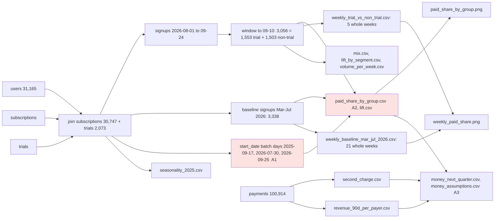

# Review: Trial conversion and the keep decision

## Verdict
**Think on it**: the three Small fixes hold and the trial lift (+14.1 pp against same-day non-trial signups) reruns exactly in all 5 whole weeks, but the 2026-07-30 batch of subscription start dates, the day before trials launched, is still unexplained (A1).

## Data flow

## Code review
- No open code findings. C1 is fixed: both weekly series now keep only Monday-to-Sunday weeks inside their windows (21 baseline weeks, Mar 2 to Jul 26; 5 trial weeks, Aug 3 to Sep 6), and the chart title matches.

## Analysis review
- **A1 Needs the user** Still open. `subscriptions.start_date` is set in batches (2026-07-30 for signups 2026-05-01 to 07-29, 2026-09-25 for signups 2026-07-30 to 09-24, and 2025-09-17 before that), so 360 of the 589 non-trial payers in the window have a plan that has not yet started or been paid. The plan field stays level and the direction is conservative, so the lift stands. Where: subscriptions.start_date; paid_share_by_group.csv. Fix: ask what changed on 2026-07-30 and whether a plan on a not-yet-started row is firm; the brief states that the non-trial rate counts plans not yet paid.
- **A2 Small fix** Changed, mostly fixed: the started-only row is gone from lift.csv and the script says why, but paid_share_by_group.csv still carries the `paid_share_started_only` column (15.2% for non-trial), which a reader could quote as a conversion rate. Where: paid_share_by_group.csv, analysis.py:123,131. Fix: drop the column or rename it to say it measures the batch start date; keep `scheduled_paid`.
- **A3 Note** Fixed. money_next_quarter.csv now sizes the whole quarter for both trials as now and trials for all signups, revenue inside the 13 weeks next to first-90-day revenue, with every assumption in money_assumptions.csv. Carry into the brief: the "trials for all signups" rows assume the no-trial half responds like those who got one, which rests on the split being random (consistent with random, not proven); the central and high cases use the Aug-Sep signup rate, whose 3.5x jump on 2026-08-01 is unexplained, and the low case uses the Mar-Jul rate; trial running costs are not counted.
- **A4 Note** Unchanged from the first review. Retention cannot serve as a warning sign (143 of 143 trial converts charged on day 30; only 33 Aug non-trial starts because most were batched to 09-25). Trial assignment balances on every recorded field. Segment lifts rest on 270 to 640 signups each and are not tested against each other; do not rank segments. Seasonality (Aug 2025 +1.5 pp over Mar-Jul 2025) is small next to the lift.

## Checked
- Recheck: C1 and A3 fixed; A2 changed (row removed, column left); A1 and A4 open as before.
- Rerun from a copy matches all 16 result files and the printed output exactly; joins do not fan out, parts sum to totals, matured trials have no open outcome.
- Dates: analysis date 2026-09-24 throughout; trial users counted once their 14-day window closed (signups to 2026-09-10), non-trial from the same days; weekly series now whole weeks only; baseline Mar-Jul 2026 at the same $12 price.
- Source data (Act 6): not repeated, as no fix touched the fields tested; the first review found the plan field and matured trial conversion level, and start_date set in batches (A1).
- Both charts opened: the weekly chart shows 5 whole weeks with the best pre-trial week at 47.4%, trial users above it in all 5; the bar chart starts at zero and matches its title.

## Not checked
- Whether trial assignment was random: not recorded in the data; only balance on recorded fields was checked (A4).
- Whether plans on rows that start 2026-09-25 will be paid: no payments exist after 2026-09-24.
- Retention beyond the first renewal: out of scope in the frame and too few months of data.

## Proposed quirks
- **Batched start dates.** `subscriptions.start_date` is set in batches for subscriptions that had not yet started: 3,377 rows start on 2025-09-17 (signups 2025-06-21 to 09-17), 1,052 on 2026-07-30 (signups 2026-05-01 to 07-29) and 1,468 on 2026-09-25 (signups 2026-07-30 to 09-24, 21 of them trial users), so the gap from signup to start is not a behaviour measure around those dates; the plan field is not affected.
- **Future start dates, corrected count.** 1,549 subscriptions start after 2026-09-24 (967 free, 425 monthly, 157 annual), 1,468 of them on the 2026-09-25 batch day and mostly non-trial signups, so they are not mainly trials.
