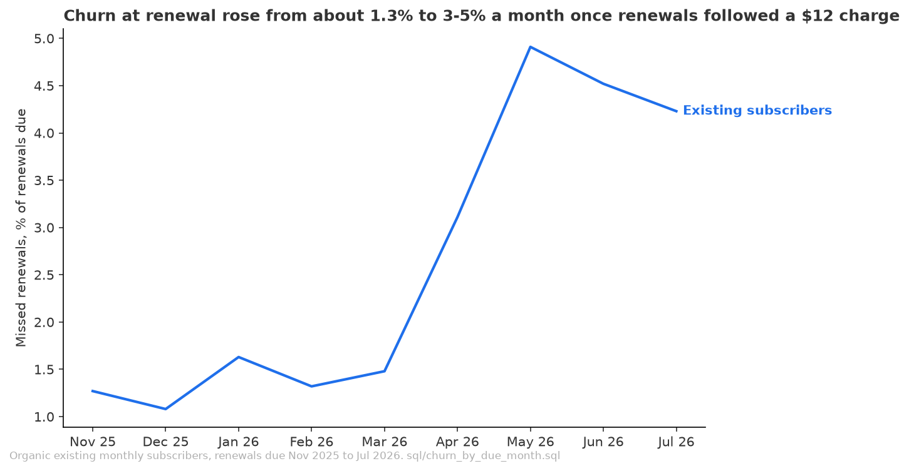
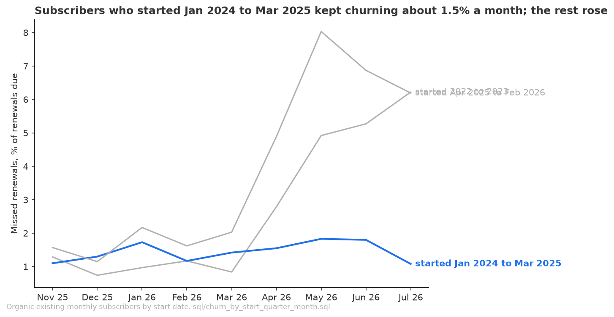
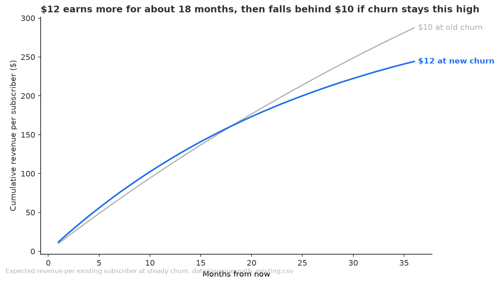

# Brief: March 2026 price increase and retention

## Question
Should Beam roll back part of the March 2026 monthly price increase ($10 to $12), and for which customers?

## Recommendation
**Keep $12 for now, and test a rollback on new monthly signups: give a random half $10 for three months and compare who cancels.**
Churn rose far past what the higher price can absorb, yet existing subscribers still paid $30k more from March to July than at $10. New signups carry the most risk: at their current churn, a year of them brings in $29k less in their first 12 months than at $10.
Tentative: with only before-and-after data, season is not ruled out; churn has not settled; and 2024 starters did not react, for no known reason.
What would change this: if the $10 group cancels clearly less, roll back for new signups and test existing subscribers the same way; if not, $12 stays.

**Open for you**
- Are you willing to charge some new signups less for three months, knowing some may notice?
- Churn jumped in April, not March. Did anything else change for monthly subscribers in April 2026?

## Key Takeaways
- Churn (the share of monthly renewals that go unpaid) rose from 1.3% before March to 4.2% from April to July.
- $12 still earns more than $10 so far, but at July's churn it falls behind within 15 months.
- Subscribers who started in 2024 stayed near 1.5%; earlier and later starters reached 6.2% by July.

## Findings
### Churn tripled from April and stayed high

- A 214% rise, against the 20% the higher price can absorb. March itself barely moved.
- Limit: no earlier year is a fair comparison, so season is not ruled out. Annual subscribers, whose price did not change, held at 0.4%, but on about five cancellations.

### The rise sits in some groups, not all

- Starters from 2022 to 2023 and from April 2025 rose to 6.2% by July; the newer group is the grey line peaking in May. Nobody knows why 2024 starters held steady, so a rollback by start date rests on an unexplained pattern.
- New signups rose about as much as existing subscribers over the same months (3.6 against 3.1 times), and the annual share barely moved: not more price-sensitive.

### $12 has paid so far, but not for long at today's churn

- The chart uses March to July churn. At July's churn, the two rising groups fall behind within 9 to 10 months.
- Limit: five months observed, shorter than any crossover, and churn is still moving.

## Appendix
### How this was done
- Data: payments, subscriptions and users from Beam's database; analysis date 2026-09-24.
- Population: paid monthly subscribers with no trial; existing ones grouped by start date, region, device and tenure; new monthly starts compared at the same renewal number. The 2025-09-17 signup block is shown apart (2.8% before, 6.3% April to July) and left out of the headline.
- Window: renewals due 2025-11-01 to 2026-02-28 (at $10) against 2026-03-01 to 2026-07-31 (at $12).
- Measure: a renewal is missed when no charge follows 30 days after the last one. Break-even: with steady churn, revenue per subscriber is price divided by churn, so $12 earns more only while churn rises by less than 20%.
- Money: observed March to July revenue at $12 against $10 at old churn; projections assume churn holds at the March to July, April to July or July rate.

### Sources
- Churn tripled from April and stayed high: data/churn_rate_by_due_month.csv, data/headline_churn.csv, data/annual_reference.csv; sql/churn_by_due_month.sql, sql/annual_churn_by_month.sql; analysis.py (headline: existing subscribers; plan mix and annual reference).
- The rise sits in some groups, not all: data/churn_by_cohort_group.csv, data/churn_after_by_month_cohort_group.csv, data/churn_by_start_quarter.csv, data/new_start_summary.csv, data/new_paid_start_mix.csv; sql/churn_by_start_quarter_month.sql, sql/new_start_churn_by_renewal.sql, sql/new_paid_starts_by_month.sql; analysis.py (start cohorts; new starts at the same renewal number; plan mix and annual reference).
- $12 has paid so far, but not for long at today's churn: data/churn_by_cohort_group.csv, data/money_at_stake.csv, data/revenue_path_existing.csv; sql/churn_by_due_month.sql, sql/churn_by_start_quarter_month.sql, sql/new_start_churn_by_renewal.sql; analysis.py (start cohorts; money for the whole monthly base).

### Checks
- Checked: 10 of 10 checks pass (every monthly charge $10 before and $12 from 2026-03-01, no join fan-out, no trial users in the window, every renewal decided by the analysis date, segments sum to totals); a rerun reproduces all 24 result files exactly.
- Not checked: why 2024 starters did not react, including a recording difference in their payments; engagement of churners as another cause; 235 block subscriptions with no payments; a same-season year-ago baseline; whether projected churn holds beyond five months.
- Out of scope: trials and anything from 2026-08-01; September to October 2025 as a baseline; free users; plan switches.
- Review findings: C1 Small fix: both rising groups share one grey in the start-date chart; chart left as is, and the finding names the line that peaks in May.
- Other review findings: 3 Notes, in review.md.
