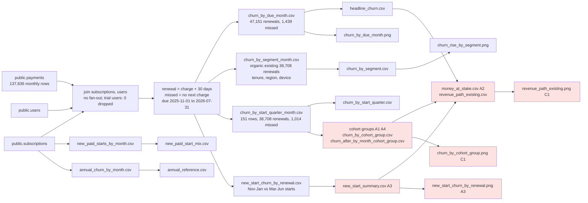

# Review: March 2026 price increase and retention

## Verdict
**Think on it**: the round 1 fixes are in and rerun exactly, but the start cohort with no churn rise is still unexplained, and the money call rests on churn rates that have not settled.

## Data flow

## Code review
- **C1 Small fix** In the cohort chart the two grey end labels ("started 2022 to 2023", "started Apr 2025 to Feb 2026") print on top of each other because both lines end at the same July rate, so a reader cannot tell the rising groups apart; in the revenue path chart the x axis label collides with the source line. Where: analysis.py:345-350, analysis.py:361-367. Fix: give the two grey lines distinct labels or an offset, and leave room between the x label and the source line.

## Analysis review
- **A1 Needs the user** (open from round 1) Existing subscribers who started January 2024 to March 2025 still show no churn rise (1.3% before, 1.5% after, interval on the change crosses zero), while those who started before 2024 or from April 2025 rise to about 4% to 6%; all paid $12 and nothing in the data explains a boundary set by start date, and no answer is recorded yet. Where: churn_by_cohort_group.csv. Fix: ask the user what was different for people who joined in that span (a price-lock promise, a partner or channel, an offer); it decides whether the rollback targets everyone outside that group and whether it can serve as a same-season control.
- **A2 Small fix** The after-window churn the money rests on has not settled: the 2022 to 2023 starters climb every month (2.8% in April to 6.2% in July) while the April 2025 to February 2026 starters peaked in May and are falling, so a steady-rate projection from the Mar to Jul or Apr to Jul average can be off in either direction, and the three horizons already disagree (observed Mar to Jul gain positive for every group, 12-month gain negative for two groups at the Apr to Jul rate, lifetime negative). Where: churn_after_by_month_cohort_group.csv, churn_by_cohort_group.csv, analysis.py:219-237. Fix: per cohort group, add the money at stake under the latest month's rate next to the averaged ones, state that the rate is still moving, and keep any rollback call tentative.
- **A3 Small fix** The new-start comparison sets renewals due Dec to Feb at $10 against renewals due Apr to Jul at $12, the same months existing subscribers' churn jumped for reasons that A1 shows were not uniform, so the gap mixes price with whatever moved churn in Apr to Jul; the season note names this, but the chart title still credits the price and says "several times more" though renewal 3 is about twice. Where: new_start_churn_by_renewal.png, new_start_summary.csv, analysis.py:352-359. Fix: set the new starts' rise beside existing subscribers' rise over the same due months, and retitle the chart from that result without a causal claim.
- **A4 Small fix** The flat group's boundaries were picked after seeing the data, and its last quarter does not fit it: 2025-Q1 starters rose +67% relative, above the 20% break-even line, as did 2024-Q4 (+26%). Where: churn_by_start_quarter.csv, analysis.py:182-187. Fix: show the per-quarter rises next to the group result and check the group with and without 2025-Q1, so the claim names the span that is actually flat.
- **A5 Note** Season still cannot be separated by a year-ago baseline; annual reference churn is flat but rests on about 5 anniversary churners; the 2025-09-17 block rises too; new paid start mix is steady; the observed Mar to Jul window (5 months) is shorter than every crossover point (11 months or more), so the positive observed gain cannot test the long-run loss; the segment chart and the revenue path chart still pool the cohort groups that A1 separates.

## Checked
- Recheck: C1 (dollar signs, axis label) fixed; A2 fixed (start quarter split added, segment title rewritten); A3 fixed in part (month-by-month rates and observed revenue added; the unsettled rate is now A2); A4 fixed (year of new starts, intervals per renewal, season named); A1 still open.
- Rerun: the new query `churn_by_start_quarter_month` rerun (151 rows), the other 10 inputs unchanged since round 1; a copy of the script reproduces all 24 result files; 10 of 10 checks pass and start quarters add back to 38,708 renewals and 1,014 missed.
- Dates and windows: unchanged since round 1; analysis date 2026-09-24, renewals due 2025-11-01 to 2026-07-31 all decided; before (4 months) and after (5 months) differ in season, named but not resolved.
- Source data (Act 6): outcome fields not retested, since no fix touched them; start_date, now a split, carries midnight times through 2025-Q3 and real times from 2025-Q4, a boundary that does not match the flat cohort, so that cohort is not a recording artefact of start_date.
- All five charts opened; titles match their results apart from C1 and A3.

## Not checked
- Why the January 2024 to March 2025 starters did not react; only the user can say (A1).
- Engagement (sessions) of churners before and after March, as another explanation for the rise; not a field check.
- Whether the 235 paid 2025-09-17 subscriptions with no payments would change the block result; they cannot enter the renewal measure.

## Proposed quirks
- **Price rise skipped 2024 to early 2025 starters.** Monthly subscribers who started January 2024 to March 2025 show no churn rise after the March 2026 price increase (about 1.3% to 1.5% of renewals missed a month before and after), while earlier and later starters rise from about 1.3% to 4% to 6% from April 2026; all paid $12. Unexplained; split existing subscribers by start cohort in any churn comparison across March 2026.
