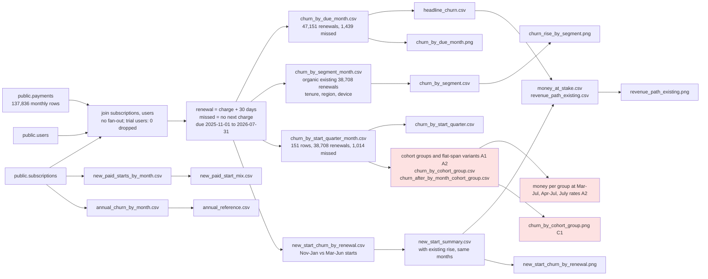

# Review: March 2026 price increase and retention

## Verdict
**Ship it**: the round 2 fixes are in and rerun exactly, and what is left are limits the brief must carry: the flat start cohort is unexplained and the projected rates have not settled, so any rollback call stays tentative.

## Data flow

## Code review
- **C1 Small fix** (changed from round 2) The end labels of the cohort chart no longer overlap, but both rising groups are drawn in the same grey and meet at the same July point, so a reader still cannot tell which grey line is the one that peaked in May. Where: analysis.py:367-378, churn_by_cohort_group.png. Fix: give the two rising groups distinct shades or label each line at a point where they are apart.

## Analysis review
- **A1 Note** (was Needs the user) The user does not know why existing subscribers who started January 2024 to March 2025 show no churn rise (1.3% before, 1.5% after, interval on the change crosses zero) while earlier and later starters rose; the variants show it holds for 2024 starters alone, so it is not a product of the chosen edges. Where: churn_by_cohort_group.csv. Fix: in the brief, call the pattern unexplained, offer no reason for it, do not use the group as a same-season control, and say that any rollback targeted by start date rests on a pattern nobody can yet explain.
- **A2 Note** (fixed from round 2) The money now shows three projected rates per group next to the observed Mar to Jul gain, and they point different ways: the observed gain is positive for every group, while at the July rate the 2022 to 2023 and April 2025 to February 2026 starters fall behind $10 within 9 to 10 months and the 2022 to 2023 starters are still climbing. Where: churn_by_cohort_group.csv, churn_after_by_month_cohort_group.csv. Fix: in the brief, show observed and projected side by side, say the rate is still moving, and keep any rollback recommendation tentative.
- **A3 Note** Other limits to carry: season still cannot be separated by a year-ago baseline; the new starts' rise (3.6 times) is close to existing subscribers' rise over the same due months (3.1 times), so the new-start gap is mostly what moved everyone in Apr to Jul and is not evidence that new signups react more; the robust flat span is 2024 (2025-Q1 starters rose +67%), so the brief should name that span; annual reference churn rests on about 5 anniversary churners; the observed window (5 months) is shorter than every crossover point; the segment and revenue path charts pool the cohort groups that A1 separates.

## Checked
- Recheck: A2 fixed (July-rate money per group), A3 fixed (existing rise beside new starts, retitled without a causal claim), A4 fixed (Jan to Dec 2024 and Jan to Sep 2024 variants both flat, per-quarter rises in churn_by_start_quarter.csv); A1 answered by the user as unknown, now a Note; C1 changed, still open in part.
- Rerun: SQL and its 11 input files unchanged since round 1's rerun; a copy of the script reproduces all 24 result files exactly; 10 of 10 checks pass.
- Dates and windows: unchanged; analysis date 2026-09-24, renewals due 2025-11-01 to 2026-07-31 all decided; before (4 months) and after (5 months) differ in season, named but not resolved.
- Source data (Act 6): not repeated, since no fix touched the fields tested; round 2 found start_date's change from midnight to real times in 2025-Q4 does not match the flat cohort's edges.
- The three changed charts opened: titles match their results; the revenue path x label no longer collides with the source line.

## Not checked
- Why the January 2024 to March 2025 starters did not react; the user does not know, and no field check was run to rule out a recording difference in payments for those cohorts alone.
- Engagement (sessions) of churners before and after March, as another explanation for the rise.
- Whether the 235 paid 2025-09-17 subscriptions with no payments would change the block result; they cannot enter the renewal measure.

## Proposed quirks
- **Price rise skipped 2024 starters.** Monthly subscribers who started in 2024 (and, less clearly, early 2025) show no churn rise after the March 2026 price increase (about 1.3% to 1.5% of renewals missed a month before and after), while earlier and later starters rise from about 1.3% to 4% to 6% from April 2026; all paid $12. Unexplained, and the business does not know why; split existing subscribers by start cohort in any churn comparison across March 2026.
