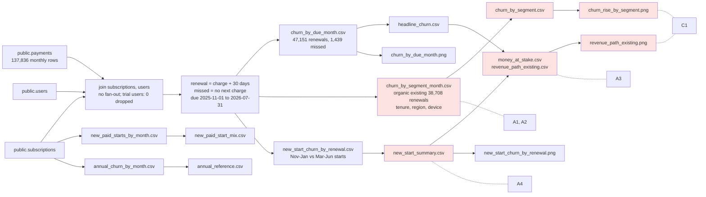

# Review: March 2026 price increase and retention

## Verdict
**Think on it**: the numbers rerun exactly and the outcome is recorded the same way throughout, but a start-cohort split the analysis left out picks out a group with no churn rise, which undoes "no group stands out" and needs the user to say why.

## Data flow

## Code review
- **C1 Small fix** Dollar signs in chart text render as matplotlib math: the revenue path title reads "12earnsmore...10" in italics and the segment chart's source line reads "10to12"; the revenue chart's x axis also has no label. Where: analysis.py:256, analysis.py:270. Fix: escape "$" as "\$" in chart strings and label the x axis "Months since renewal".

## Analysis review
- **A1 Needs the user** Existing subscribers who started January 2024 to March 2025 show no churn rise (about 1.3% a month before and after, steady by `stable_over_time`), while those who started before 2024 or from April 2025 go from about 1.3% to about 6% and hold there; every one of them paid $12, and nothing in the data explains a boundary set by start date. Where: start-cohort check in this review, against churn_by_segment.csv. Fix: ask the user what was different for people who joined in that span (a price-lock promise, a partner or channel, an offer), since it decides whether this group is a real lever and whether it can act as a control for season.
- **A2 Small fix** The frame names start cohort as a split, but existing subscribers are split only by tenure band, region and device; tenure bands cut across the start-date boundary in A1, so the 12 to 24 months band merely looks mildest (+71%) and the chart title "no group stands out for a rollback" does not hold. Where: sql/churn_by_segment_month.sql, analysis.py:254. Fix: add start quarter (or start half-year) as a dimension for existing subscribers, with intervals and money at stake per cohort, and rewrite the segment chart title from the result.
- **A3 Small fix** The call rests on a steady-churn projection whose two horizons point opposite ways (12-month gain +$7 per existing subscriber, lifetime $333 at $12 against $751 at $10), and the projected rate is the pooled Mar to Jul rate, which mixes a flat group with one at about 6% and includes March, where the first $12 renewal showed no rise. Where: money_at_stake.csv, analysis.py:221-238. Fix: per cohort group from A2, show that the after rate has held month by month (Apr to Jul), show observed Mar to Jul revenue against the $10 counterfactual next to the projection, and treat a rollback call as tentative if they still disagree.
- **A4 Small fix** New-start money covers one month's cohort (195 subscribers), not the whole group over a stated period, and the new-start comparison sets renewals due Dec to Feb against renewals due Apr to Jul (different season), with renewal 3 at $10 resting on 142 renewals. Where: new_start_summary.csv, analysis.py:198. Fix: size new-start money for a year of new starts, add confidence intervals per renewal number, and name the season difference next to the result.
- **A5 Note** Season cannot be separated by a year-ago baseline (frame open question), though the flat cohort in A1 may serve as a same-season control once the user explains it; annual reference churn is flat (0.42% to 0.41% a month) but rests on 5 anniversary churners, so it is weak as a control; the 2025-09-17 block is shown apart and rises too; new paid start mix is steady (annual share 24% to 25%, about 195 to 198 monthly starts a month, region mix shifts a few points toward EU and India).

## Checked
- Rerun: all 10 queries rerun and all 20 result files match; the script's 9 checks pass; joins do not fan out and the trial exclusion removes nobody.
- Dates and windows: analysis date 2026-09-24 from payments and users per index.yaml; renewals due 2025-11-01 to 2026-07-31, all decided by the analysis date; before (4 months, Nov to Feb) and after (5 months, Mar to Jul) differ in season, which the frame names but does not resolve.
- Source data (Act 6): charge gaps are exactly 30 days and every missed renewal has an end date in every month, so the outcome is recorded the same way throughout; the April 2026 step shows in every payment method but vanishes in the January 2024 to March 2025 start cohorts, so it is behaviour or mix, not a recording break.
- Price charged: every monthly charge is $10 before 2026-03-01 and $12 after, for every start year, so no cohort was grandfathered.
- Fit to frame: question, population, break-even line, money at stake and plan-mix check are covered; start cohort for existing subscribers is not (A2).

## Not checked
- Engagement (sessions) of churners before and after March, as another explanation for the rise; not a field check, and the user knows of no other change.
- Whether the 235 paid 2025-09-17 subscriptions with no payments would change the block result; they cannot enter the renewal measure.
- Medians of the end-date gap by month with `stable_over_time` kind median; the share checks and raw medians (13.5 to 19.5 days) showed no step.

## Proposed quirks
- **Price rise skipped 2024 to early 2025 starters.** Monthly subscribers who started January 2024 to March 2025 show no churn rise after the March 2026 price increase (about 1.3% of renewals missed a month before and after), while earlier and later starters rise from about 1.3% to about 6% from April 2026; all paid $12. Unexplained; split existing subscribers by start cohort in any churn comparison across March 2026.
