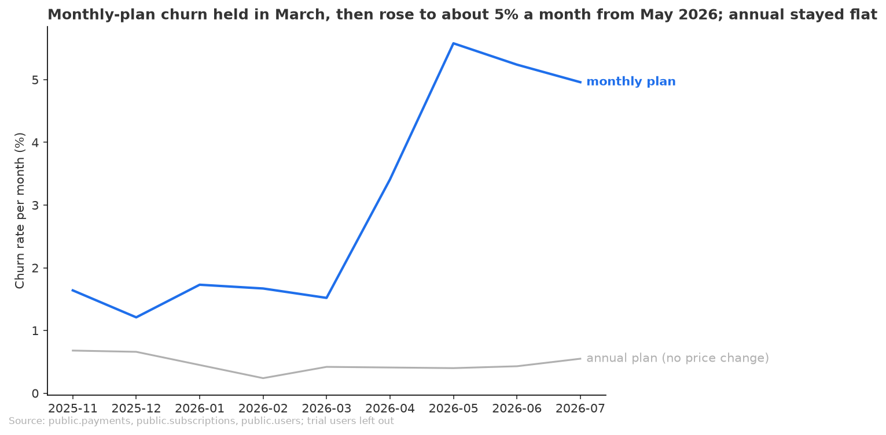
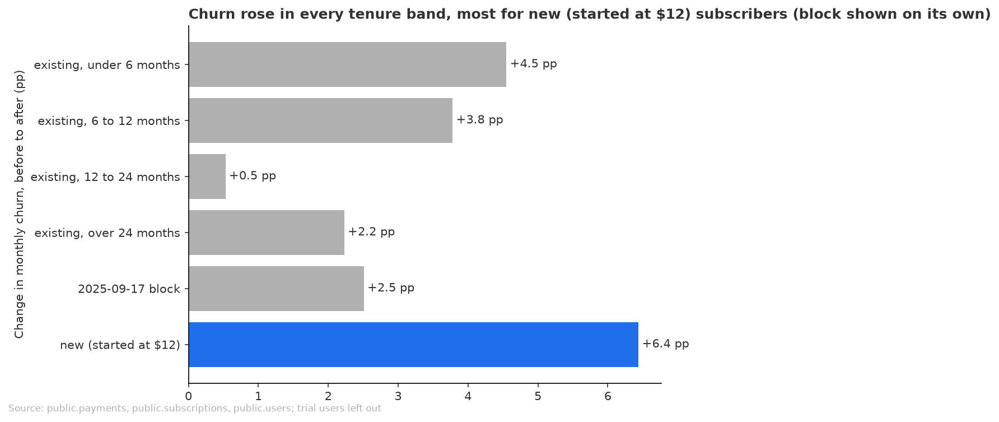

# Brief: March 2026 price rise and who to roll back for

## Question
Should Beam roll back part of the March 2026 monthly price rise ($10 to $12), and for which customers?

## Recommendation
**Test a return to $10 for new monthly sign-ups with a random holdout, and keep $12 for existing subscribers for now.**
New subscribers reacted most: their churn (the share of monthly renewals left unpaid) is up 6.4 percentage points on earlier joiners at the same stage, and over 12 months $12 earns about $17k less from them than $10.
Tentative: a before-and-after comparison cannot separate price from season, and so far $12 still brought in slightly more from them than $10 would have.
What would change it: if $10 sign-ups churn as much as $12 ones, price is not the cause and $12 stays; if existing subscribers' churn does not ease from July, size a wider rollback.

**Open for you**
- Can Beam price by join date? Some older join groups also look better off at $10.
- Did anything apply only to 2024 joiners (a deal, a kept price, a channel)? They barely reacted, and the data does not say why.

## Key Takeaways
- Monthly churn rose from 1.6% before the rise to 4.1% after, and had not eased by July.
- New subscribers churn 8.3% in their first three renewals, against 1.9% for those who joined at $10.
- For all monthly subscribers together, $12 against a full rollback is too close to call over 12 months: from $23k behind to $9k ahead.

## Findings
### Churn rose from the second $12 renewal on, while the annual plan stayed flat

- It held in March, then climbed to about 5% a month from May, in every region and device.
- Limit: no clean season check exists, so part of the rise may not be price.

### New and recent subscribers reacted most, long-standing ones least

- Existing subscribers under 6 months' tenure rose 4.5 points; those at 12 to 24 months only 0.5.
- Limit: gaps between groups are not tested against chance.

### For new subscribers, $12 earns less than $10 over the next 12 months
**About $17k less** at $12 than at $10, from July's new subscribers.
- The loss holds whichever months' churn is used.
- Limit: assumes the whole rise is price, and ignores any effect on sign-ups.

## Appendix
### How this was done
- Paid monthly subscribers from Beam's payments and subscriptions, users with a trial record left out. Churn is missed renewals over renewals due. Before: renewals due November 2025 to February 2026 (all charged $10). After: March to July 2026 (all charged $12). Analysis date 2026-09-24, so July renewals are closed.
- Existing subscribers are split by tenure band; new subscribers (joined from March 2026) are compared with earlier joiners at the same stage (first three renewals). The 2025-09-17 bulk block of starts is kept apart.
- Money: 12-month revenue at $12 against a rollback to $10, per join group, from the July 2026 base, under three $12 churn rates (May to July, March to July, July only). Observed money for March to July is set against the same subscribers carried forward at $10 churn.

### Sources
- Churn rose from the second $12 renewal on: data/churn_by_month.csv, data/churn_overall.csv, data/annual_churn_before_after.csv, data/churn_by_region_device.csv; sql/renewals_by_segment.sql, sql/annual_churn_context.sql, sql/renewals_by_region_device.sql; analysis.py (Headline; Segments, annual and region context).
- New and recent subscribers reacted most: data/churn_change_by_segment.csv, data/churn_existing_by_tenure_no_block.csv, data/churn_new_vs_prior_starters.csv; sql/renewals_by_segment.sql, sql/early_renewals_by_start_group.sql; analysis.py (Segments; Charts).
- For new subscribers, $12 earns less: data/revenue_keep_vs_rollback_by_group.csv; sql/renewals_by_start_cohort.sql, sql/early_renewals_by_start_group.sql; analysis.py (Money).

### Checks
- Checked: every renewal before March was charged $10 and every one from March $12; segments, cohorts, regions and devices add to the month totals; payments join to subscriptions with no rows lost or repeated; all result files rerun exactly at review; the April 2026 step is behaviour, not a recording change.
- Not checked: season against price (no clean comparison exists); money by tenure band (no result table holds it, so the money is split by join date); observed money by month per group, so whether the new-subscriber gain has already turned; the effect of price on sign-ups; differences between groups against chance; whether churned subscribers came back; plan switches (not visible in payments, so not counted); the 2026-07-30 block of starts.
- Out of scope: everything from 2026-08-01, users with a trial record, baselines before November 2025.
- Review findings: A1 Needs the user: per-group money calls rest on join date, not a lever named in the frame; the recommendation rests on new versus existing, a frame lever, and the join-date and 2024 questions sit under Open for you; why 2024 joiners did not react is not verified.
- Review findings: A2 Small fix: observed March to July gain is positive (about $1k for new subscribers, $33k for all) while the 12-month projections are negative; the monthly trend was not produced, not verified, so the recommendation is tentative.
- Other review findings: 3 Notes, in review.md
