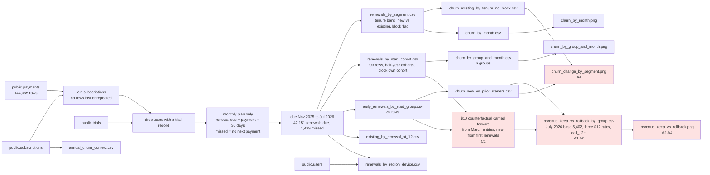

# Review: March 2026 price rise and monthly retention (recheck 2)

## Verdict
**Think on it**: the round 2 fixes hold and the numbers rerun exactly, but the money answer still splits customers by start date, a split the frame never named as one Beam can price by, and for three groups the observed months favour $12 while every projection calls for a rollback.

## Data flow

## Code review
- **C1 Note** The new $10 counterfactual carries each group's March renewals forward at one renewal per month, while real 30-day cycles put two renewals in some long months; replayed at each group's observed $12 churn, the model lands within 2% of the renewals actually paid (a little high for existing groups, a little low for new), so it slightly understates the observed gain for existing groups and overstates it for new; no sign changes. Where: analysis.py:237-246. Fix: none needed; the brief can call the observed gain approximate.

## Analysis review
- **A1 Needs the user** Still open from round 2: the per-group calls rest on start cohort (keep $12 for 2024 starters; roll back for 2022 to 2023 starters, Jan to Feb 2026 starters and new subscribers), but start cohort was added as a comparison split, not as a lever Beam can price by, and the frame's levers (tenure band, new vs existing) do not isolate these groups; nothing in the data explains why 2024 starters barely reacted. Where: frame.md Population; revenue_keep_vs_rollback_by_group.csv (call_12m); revenue_keep_vs_rollback.png. Fix: ask the user whether Beam can price by start date and whether anything applied only to 2024 starters (a deal, a grandfathered price, a channel); if start date is not a lever, return to /frame or have /analyse restate the money by the frame's levers.
- **A2 Small fix** For 2022 to 2023 starters, Jan to Feb 2026 starters and new subscribers, the observed Mar to Jul gain at $12 is positive while all three 12-month projections are negative, yet call_12m says "roll back to $10" with no qualifier; the two can differ legitimately (the observed side is sunk and includes March, before churn rose; the projection runs forward from the shrunken July base), but the results do not show which way the gain is heading now. Where: revenue_keep_vs_rollback_by_group.csv (observed_gain_mar_jul, call_12m). Fix: add the observed gain by month per group (Mar to Jul) so the brief can show whether the monthly gain has already turned, and mark a call as tentative where the observed and projected answers point different ways.
- **A3 Note** Carried from rounds 1 and 2: the rise is behaviour, not a recording change, but cause is not proven (churn held at the first $12 renewal and stepped up from April; annual and 2024 starters stayed flat; season cannot be separated). The money sizing assumes the whole rise is the price and that a rollback returns each group to its $10 rate at once; each cohort is compared with itself at an earlier tenure; new subscribers' early-tenure churn is held flat for 12 months on both sides.
- **A4 Note** Smaller points for the brief: "too close to call" for 2025 starters and the 2025-09-17 block rests only on the Mar to Jul rate, which includes the pre-reaction March, while the settled and July rates both favour a rollback, narrowly; the three-case sign test is not a noise test, and differences between groups are still not tested against noise (2024 starters' July rate rests on 12 missed renewals); the revenue chart shows only the settled case, so its bars for 2025 starters and the block read firmer than their call; both horizontal bar charts still put the value-axis label on the category axis; the 2026-07-30 block is not measured; plan switches cannot be seen in payments; the rollback for new subscribers is sized without any effect on signups.

## Checked
- Recheck of round 2: C1 fixed (the $10 side now carries March entries forward at the $10 rate, new subscribers enter at their first renewal each month; replay check in C1); A2 fixed (July rate added as a third case, call_12m marks sign changes; two groups and the total are now too close to call); A4 in part (group-by-month chart now titled for existing subscribers and starts at zero); A1 still open (frame and corrections unchanged); A3 carried.
- Rerun: renewals_by_start_cohort and early_renewals_by_start_group rerun through course-db (93 and 30 rows), the other inputs unchanged since round 1, the script rerun on them: all 22 result files match; 14 sanity checks pass, and the one flagged step (April 2026) is the change being measured.
- Dates and windows: unchanged and still right; analysis date 2026-09-24, before Nov 2025 to Feb 2026, after Mar to Jul 2026, July renewals closed well before the analysis date, nothing from 2026-08-01, trial users out.
- Source data (Act 6): not repeated, since the fixes changed only the script's money model, not the fields tested; round 1 found the April 2026 step is behaviour, not recording, and round 2 found cohort region and device mix steady with no bulk start day besides the 2025-09-17 block.
- Charts: the changed group-by-month chart and the revenue chart reopened; titles match their data; open issues in A4.

## Not checked
- Why 2024 starters did not react; sessions and engagement were not queried, and no deal or channel data exists in the tables.
- Whether subscribers who missed a renewal came back later; one subscription per user hides it.
- The observed gain by month per group (A2); that is a new result for /analyse.
