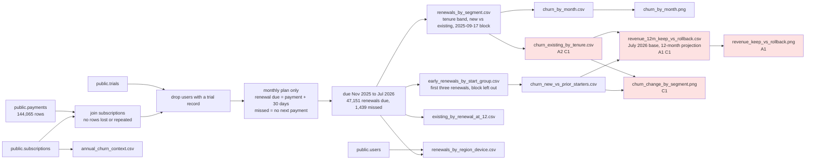

# Review: March 2026 price rise and monthly retention

## Verdict
**Think on it**: the churn rise is real and well measured, but whether keeping $12 earns or loses money over 12 months flips with the churn rate chosen for $12, so the rollback call is not settled yet.

## Data flow

## Code review
- **C1 Small fix** The 2025-09-17 block sits on one side only of two tenure comparisons: it is in the under 6 months baseline (Nov to Feb) but has aged out of it after March, and it is in 6 to 12 months after March but not before; the money table and the segment chart still use the rates with the block, so the under 6 months base (no block in July) is paired with a block-inflated $10 rate, and the ranking of existing bands changes once the block is removed. Where: analysis.py:136, 194-198, 238; churn_existing_by_tenure.csv against churn_existing_by_tenure_no_block.csv. Fix: build the money table and segment chart from the rates without the block, and show the block as its own group.

## Analysis review
- **A1 Small fix** The 12-month money answer flips with the $12 churn rate: the main rate averages March to July, which includes the March renewal (the first at $12, before churn rose), while churn settled near 5% from May; with May to July rates the total for all monthly goes from +$5,974 to -$25,906 and over 24 months turns negative. The projection also holds the rate flat for 12 months without showing it has stopped moving (it eased each month from May to July), and the observed March to July revenue against the $10 counterfactual is not shown next to the projection. Where: revenue_12m_keep_vs_rollback.csv; analysis.py:199-210; revenue_keep_vs_rollback.png shows only the main case. Fix: make the settled May to July rate the main case or show both side by side in the table and chart, add the observed March to July result next to the projection, and show the rate by month since the rise so a fading reaction is visible.
- **A2 Small fix** Tenure bands are not stable groups: the frame's start cohort split is missing, and 12 to 24 months (the only band where keeping $12 wins clearly) barely moved while both shorter and longer tenures rose, which looks like a property of the 2024 to mid-2025 starters rather than of tenure. Over the 12-month projection today's 6 to 12 months group, including the 2025-09-17 block, ages into 12 to 24 months, so a rule set by band acts on different people from those measured. Where: renewals_by_segment.sql, churn_existing_by_tenure.csv, analysis.py:191-198. Fix: add the start-cohort split from the frame, check whether the 12 to 24 months result holds by cohort, and project revenue per cohort as it ages rather than per band.
- **A3 Note** The rise is a change in behaviour, not in recording, but cause is not proven: churn held at the first $12 renewal and stepped up from April, in every payment method alike, while annual stayed flat and 12 to 24 months stayed flat. A one-cycle lag after the first $12 charge fits a price reaction; nothing in the data separates it from another April event or from season (the frame rules out a year-earlier check). The brief should say the money sizing assumes the whole rise is caused by the price and that a rollback would bring churn back to its earlier level.
- **A4 Note** Smaller points for the brief: differences between groups are not tested against noise (the new-subscriber rate rests on 142 missed renewals); the segment chart rounds its labels to whole points, so 12 to 24 months reads "0" for +0.5 pp, and a label overlaps an axis label on the revenue chart; the 2026-07-30 block (302 monthly starts) joins the new group from August but none of its renewals are measured; plan switches cannot be seen in payments, so churn may count switchers as lost; monthly starts held near 200 a month before and after March with a steady region and device mix (checked in the review only, so add it if the brief claims acquisition was unaffected).

## Checked
- Rerun: all eight queries rerun through course-db and the script rerun on them; all 18 result files match, and every sanity check in the script passed (segments add to month totals, no join fan-out, every renewal before March charged $10 and from March $12, none paid off its due date).
- Dates and windows: analysis date 2026-09-24 follows index.yaml; before is renewals due Nov 2025 to Feb 2026 and after is Mar to Jul 2026, as the frame says; renewals are charged on their due date, so July renewals were decided by 2026-07-31, well before the analysis date; nothing from 2026-08-01 on, trial users left out, Sep to Oct 2025 kept out of the baseline; before and after differ in length (4 against 5 months) and season, which the frame accepts.
- Source data (Act 6): missed renewals step up from April 2026 in every payment method; every missed renewal has an end_date before its due date in every month (no recording change), the payment-method mix is steady, and the step is absent in the steady 12 to 24 months subset and at the first $12 renewal, so it reads as behaviour, not a recording break.
- Frame fit: answers the question with monthly churn against each group's own baseline, uses the frame's levers (tenure, new vs existing), puts existing subscribers' after period at their $12 renewals, and sizes the money for each whole group over 12 months with a break-even churn per group.
- Charts: all three opened; titles match their data, axes start at zero; issues are in C1 and A4.

## Not checked
- Whether the rise holds within each start cohort (A2); the review did not compute new cuts of the answer.
- Engagement or product changes around April 2026 that could explain the timing; sessions were not queried.
- Whether subscribers who missed a renewal came back later on a new subscription; one subscription per user hides it.
