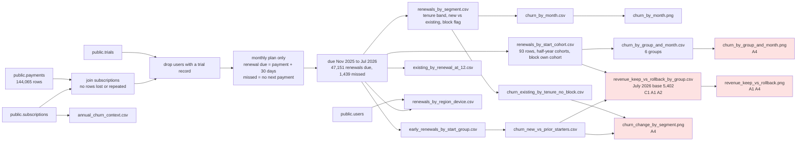

# Review: March 2026 price rise and monthly retention (recheck)

## Verdict
**Think on it**: the round 1 fixes hold and the churn rise is well measured, but the money answer now singles out 2024 starters, a group the frame never named as one Beam can price separately and whose calm nothing in the data explains, and the sign for two groups turns on which $12 churn rate is used.

## Data flow

## Code review
- **C1 Small fix** The observed Mar to Jul gain compares revenue at $12 with a $10 counterfactual built on the renewals that actually fell due at $12, so the $10 side never gets back the renewals lost to the extra churn in earlier months; the observed gain is overstated, most in the groups whose churn rose most, and for the smaller groups (Jan to Feb 2026 starters, new) the sign may not hold. Where: analysis.py:242-249, revenue_keep_vs_rollback_by_group.csv (observed columns). Fix: start the $10 counterfactual from each group's renewals due in March (or at its first $12 renewal) and run it forward month by month at the $10 rate, as the projection does.

## Analysis review
- **A1 Needs the user** The money result now points to one group: 2024 starters are the only ones where keeping $12 pays over 12 months, but start cohort was added as a comparison split, not as a lever the business can price by, and the frame's levers do not isolate them (2022 to 2023 starters, also long tenure, lose money at $12). Nothing in the data explains why 2024 starters barely reacted: their region and device mix matches the other cohorts and they hold no bulk start day. Where: frame.md Population; revenue_keep_vs_rollback_by_group.csv; revenue_keep_vs_rollback.png. Fix: ask the user whether Beam can set prices by start date and whether anything applied only to 2024 starters (a deal, a grandfathered price, a channel); if start date is not a lever, return to /frame, or have /analyse restate the money by the frame's levers.
- **A2 Small fix** The "settled" $12 rate (May to Jul average) is not settled in every group: 2022 to 2023 starters still rise each month, while the 2025-09-17 block and Jan to Feb 2026 starters fall, and for the block and 2025 starters the July rate sits right at the break-even churn, so whether $12 wins for them turns on the month chosen (the Mar to Jul rate already flips both to positive). In total the observed months favour $12 and the settled projection favours a rollback. Where: revenue_keep_vs_rollback_by_group.csv, churn_by_group_and_month.csv, analysis.py:240-256. Fix: add the latest-month rate as a third case per group and mark groups whose sign changes across the three cases as too close to call; the brief treats the total as tentative.
- **A3 Note** Carried from round 1, still open: the rise is behaviour, not a recording change, but cause is not proven (churn held at the first $12 renewal and stepped up from April; annual and 2024 starters stayed flat; season cannot be separated). The money sizing assumes the whole rise is the price and that a rollback returns each group to its $10 rate. Two limits on the cohort view: each cohort is compared with itself at an earlier tenure, which tends to hide a rise in young cohorts rather than invent one; and new subscribers' early-tenure churn is held flat for 12 months on both sides, which likely overstates the dollar gap as they age.
- **A4 Note** Smaller points for the brief: both horizontal bar charts put the value-axis label on the category axis; the group-by-month chart leaves out new subscribers (no February point) although its title speaks of every start group, and its y axis does not start at zero; differences between groups are not tested against noise (the 2024 gap looks far beyond it, the smaller groups less so); the 2026-07-30 block joins the new group from August and is not measured; plan switches cannot be seen in payments; a rollback for new subscribers is sized without any effect on signups (monthly starts held near 200 a month before and after March).

## Checked
- Recheck of round 1: C1 fixed (block is its own group, segment chart uses rates without the block, labels show one decimal); A1 fixed in part (settled rate is the main case, Mar to Jul shown beside it, observed months and monthly rates by group added) with new issues in C1 and A2; A2 fixed (start-cohort split added, the flat 12 to 24 months band traced to 2024 starters, money projected per cohort); A3 and A4 carried as Notes.
- Rerun: the new query rerun through course-db (93 rows) with the other seven inputs from round 1, the script rerun on them: all 22 result files match, every sanity check passed, including start cohorts adding to month totals and group bases adding to July renewals due (5,402).
- Dates and windows: unchanged since round 1 and still right; analysis date 2026-09-24, before Nov 2025 to Feb 2026, after Mar to Jul 2026, July renewals closed well before the analysis date, nothing from 2026-08-01, trial users out.
- Source data (Act 6): round 1 found the April 2026 step is behaviour, not recording; the fixes only added start_date, so the new check was on cohort mix: region and device shares match across cohorts within about four points and no cohort other than the 2025-09-17 block holds a bulk start day (at most 14 starts on any day).
- Charts: all four opened; titles match their data; issues in A4.

## Not checked
- Why 2024 starters did not react; sessions and engagement were not queried, and no deal or channel data exists in the tables.
- Whether subscribers who missed a renewal came back later; one subscription per user hides it.
- How much the observed gain changes once the counterfactual is fixed (C1); that is a new result for /analyse.
