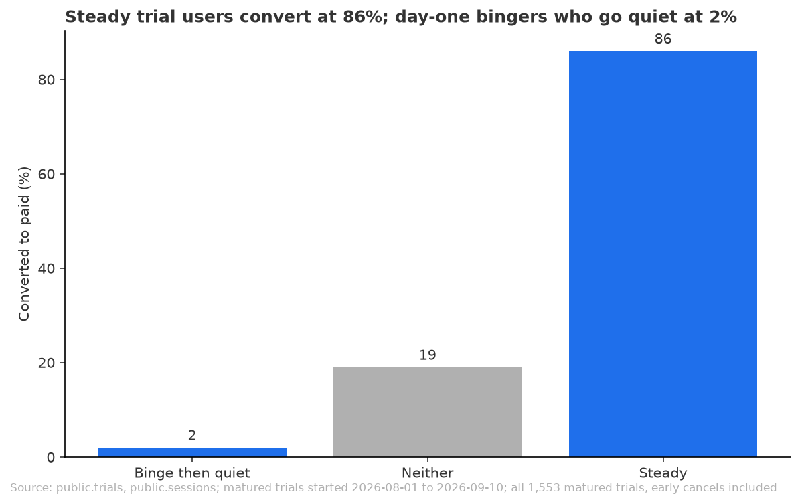
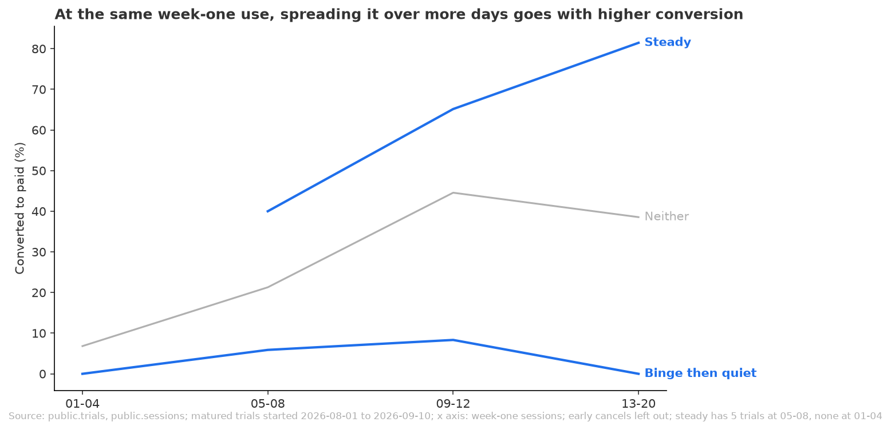
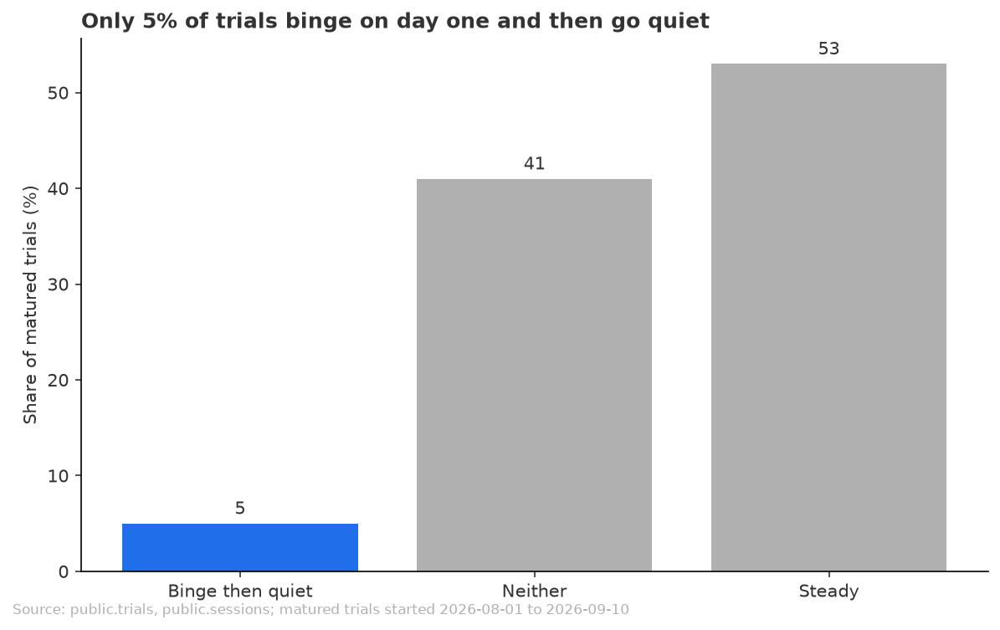

# Brief: Spreading out week one goes with far higher trial conversion

## Question
Should the onboarding emails push trial users to spread their first-week use across several days?

## Recommendation
**Yes: write the emails to bring trial users back on several days in week one, and launch them as a test against the current emails, not to everyone at once.**
Users who binge on day one and then go quiet convert 50.0 percentage points less often than steady users with the same total use in week one. The bigger prize is the 41.4% of trials in between, worth up to about $201,000 a year in first-year revenue if they converted like steady users.
Fairly confident of the direction: the gap is large under every definition tried. The money is an unchecked upper limit.
What would change this: the test showing that emails do not change when people use the app, since users who spread their week may simply be the ones who already like it.

**Open for you**
- Is a few weeks of testing acceptable before a full rollout, or is the cost of waiting too high?

## Key Takeaways
- Steady users (active on day one and 5+ of the next six days) convert at 86.0%; binge-then-quiet users (4+ sessions on day one, then active on 2 or fewer of the next six) at 5.1%.
- At equal week-one sessions the gap is still 50.0 percentage points: spreading matters, not just using more.
- Binge-then-quiet is only 5.5% of trials; the middle group, at 41.4%, is where an email could move most revenue.

## Findings
### Day-one bingers who go quiet almost never pay

- Setting aside first-week cancels, 5.1% against 86.0%, far beyond chance.
- This group is known only after day seven, so an email cannot single it out on day one.

### The gap holds at the same amount of use

- Spreading use, not heavier use, goes with paying.
- Few steady users have light weeks, so the size is rough (27.4 to 72.6 points); the direction is not.

### The middle group holds most of the money

- Middle-group users convert at 18.7%; matching steady users at the same use would add up to about $201,000 a year, against $50,000 for the binge-then-quiet group.
- These are ceilings: the data shows who converts, not what an email would change.

## Appendix
### How this was done
- Data: Beam trials, sessions, users, subscriptions and payments, analysis date 2026-09-24.
- Population: 1,553 trials started 2026-08-01 to 2026-09-10 that had run their full 14 days.
- Conversion: the share of trials that became paid at trial end.
- Groups, approved before any outcome was seen: binge then quiet (85), steady (825), neither (643). The main comparison sets aside trials canceled on days 5 to 7, leaving 1,349; 95% intervals throughout.
- Same-use comparison: steady and middle-group rates reweighted to the binge-then-quiet mix of week-one session bands.
- Money: first-year revenue per converter of $131 (28.7% on annual plans, no monthly churn assumed), trial volume scaled from six weeks to a year.

### Sources
- Day-one bingers who go quiet almost never pay: data/conversion_by_group.csv, data/group_mix.csv, data/headline_gaps.csv, data/conversion_sensitivity.csv; sql/conversion_by_group.sql, sql/conversion_sensitivity.sql, sql/conversion_by_day1_and_spread.sql; analysis.py (steps 1 and 2)
- The gap holds at the same amount of use: data/same_use_comparison.csv, data/conversion_rate_by_week1_band.csv; sql/conversion_by_week1_band.sql; analysis.py (step 3)
- The middle group holds most of the money: data/money_at_stake.csv, data/group_mix.csv, data/first_renewal_by_group.csv; sql/conversion_by_group.sql, sql/first_renewal_by_group.sql; analysis.py (steps 1 and 8)

### Checks
- Checked: group and conversion totals add up; no join fan-out; conversion recorded the same way in August and September; no sessions after a cancel; rerun of queries and script matches (review round 2).
- Checked: the gap stays between 71.7 and 83.2 points across six definitions of the groups, 67.0 points with the frame's looser 4-of-7 steady definition, and 65.0 points in the same-use comparison with 20+ trials per band.
- Not checked: money at both ends of the same-use interval (the middle-group gap runs from 6.6 to 46.9 points), so the $201,000 has no range.
- Not checked: shifts in region or device mix between August and September; whether spreading use causes conversion.
- Not checked: first paid renewal as a test of users converting by forgetting to cancel; only 2 binge-then-quiet converters, none due yet.
- Out of scope: what an email would cause (needs an A/B test); long-run retention.
- Review findings: A1 Small fix: money rows apply same-use gaps measured without early cancels to whole groups and carry no interval; not verified, so the money is stated as an upper limit and unchecked.
- Review findings: A2 Small fix: the active-days chart and targetable groups include early cancels and the chart title is cut off; not verified, so that chart and those groups are not used in the body.
- Other review findings: 1 Note, in review.md
