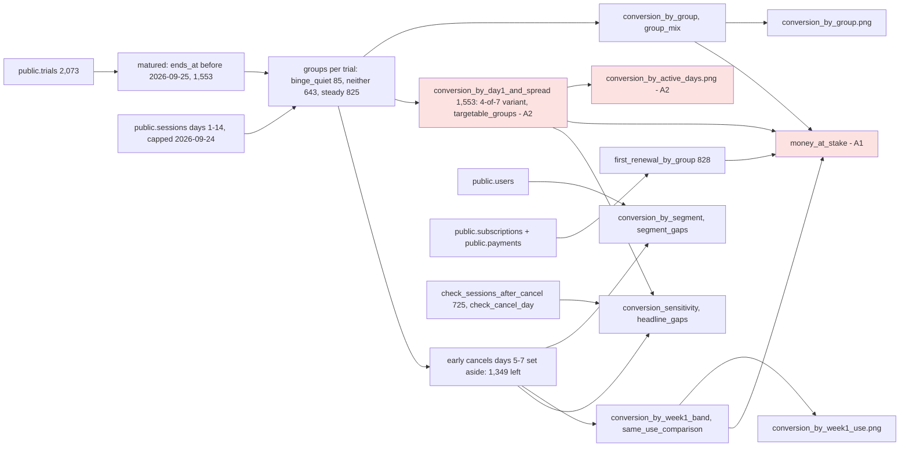

# Review: Day-one binge vs steady trial conversion

## Verdict
**Ship it**: every round 1 finding is fixed or reduced to a sizing detail, the rerun matches, and the gap is far beyond noise under every definition, including the frame's 4-of-7 steady and the same-use comparison; the open Small fixes change how big the money is, not which way the answer points.

## Data flow

## Code review
- No open code findings. Round 1 C1 is fixed: both checks now test their condition (0 sessions after the cancel day across 725 canceled trials; cancels fall on trial days 5 to 14), and the sessions query counts canceled trials only.

## Analysis review
- **A1 Small fix** The money rows apply same-use gaps measured without early cancels to every trial in the group, early cancels included (binge_quiet: gap from 35 trials applied to 85, of whom 46 canceled by day 7; neither: gap from 345 applied to 643), and carry no interval although the neither same-use gap runs from about 7 to 47 pp. Where: analysis.py:247-262, money_at_stake.csv. Fix: apply each gap to the population it was measured on (or say which one), and show money at both ends of the gap's interval next to the point value.
- **A2 Small fix** The active-days chart, targetable_groups and the "quiet vs stayed" money row use all matured trials, so early cancels (0% conversion by definition, and a cancel ends sessions) sit in the low-activity bars, which the chart does not say; its title is also cut off at the right edge. Where: analysis.py:288-294, charts/conversion_by_active_days.png, targetable_groups.csv. Fix: state the population in the chart source line (or draw it without early cancels, as the main variant does) and shorten the title.
- **A3 Note** Carry into the brief: the gap is an association, not what an email would cause (frame Out of scope; an A/B test answers it), so every money figure is a ceiling on what emails could reach; binge_quiet is known only after day 7 and is 5% of trials, while the group an email can pick out on day 1 (4+ day-one sessions, 46%) converts above average and the neither group (41%) is the larger pool; the definitions were approved by the user before outcomes were seen (frame.md, 2026-11-17), with steady at 5+ of days 2 to 7 and the frame's 4-of-7 shown as a variant; the same-use comparison leans on 5 steady trials in the 05-08 band, and its 20+ per band version points the same way; only 1 of 15 segments has 30+ trials in both groups; every trial user signed up on the trial start day, so the new vs existing split is empty; the first-renewal check is thin (2 binge_quiet converters, none due yet); the cohort is the first six weeks after launch, so future trials may differ; first-year value assumes no monthly churn.

## Checked
- Recheck of round 1: C1 fixed (real checks, canceled trials only); A1 fixed (frame.md records the user's approval of the definitions before outcomes were seen, and the 4-of-7 steady runs as a variant); A2 changed (targetable groups and money for the neither group and same-use gaps added; the population mix in the money rows is now A1); A3 fixed (same-use gaps carry intervals and a 20+ per band version, binge_quiet is on the week-one-use chart, the headline chart names its population).
- Rerun: the two new or changed queries (check_sessions_after_cancel, conversion_by_day1_and_spread) rerun through course-db and match; with the unchanged query outputs, the script copy reproduces all 24 result files and every check printed ok.
- Dates and windows: unchanged since round 1; analysis date 2026-09-24, matured trials started 2026-08-01 to 2026-09-10, all with their full 14 days; the new spread query uses the same caps and leaves out the ends_at day.
- Source data (Act 6): not repeated, since no fix touched the fields tested in round 1 (conversion share, day-one sessions, active days 2 to 7 and trial length were stable by start month; the September cancel-day shift is behaviour, outside any compared baseline).
- Charts opened: titles match their numbers and axes start at zero; issues are in A2.

## Not checked
- Shifts in region or device mix between August and September starts.
- Whether spreading use causes conversion; the data is observational and the frame rules it out of scope.
- Rerun charts were regenerated but not compared image by image with the originals.

## Proposed quirks
- **Every trial starts on its user's signup day.** All 2,073 trials in public.trials start on the same date as users.signup_date, so no existing free user has started a trial and a new vs existing user split is empty.
- **Trial users vanish from sessions after a conversion or cancel.** Converted trial users have no sessions on or after their trial's ends_at day (0 of 679 that ended by 2026-09-17), and canceled trial users have none between the cancel day and ends_at (0 sessions across 725 canceled matured trials), though most return on the free plan after it; trial users' use after converting cannot be read from public.sessions.
