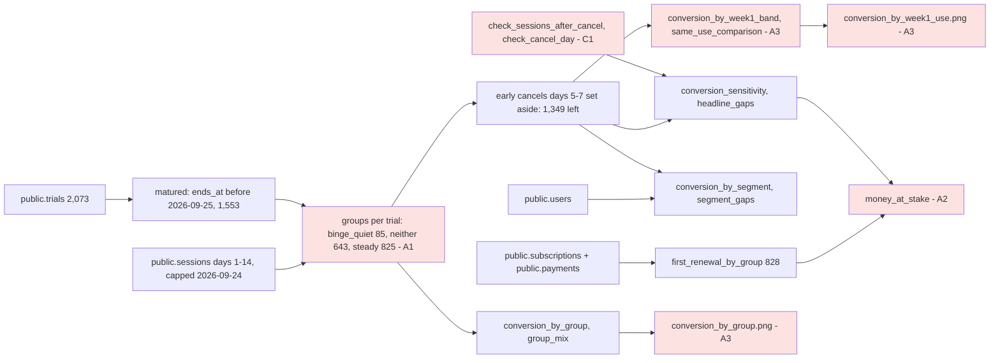

# Review: Day-one binge vs steady trial conversion

## Verdict
**Think on it**: the numbers rerun exactly and the gap is far beyond noise, but the group definitions were never confirmed with the user, and the money and rates cover only a group the emails cannot reach in time.

## Data flow

## Code review
- **C1 Small fix** Two checks are hard-coded to pass (`"ok": True`), so they would still pass if a cancel fell on days 1 to 4 or sessions appeared after a cancel; the days_1_4_all_trials variant rests on the first one, and the sessions-after-outcome count is empty by construction for converted trials (their outcome day 15 is outside the window). Where: analysis.py:176-185, sql/check_sessions_after_cancel.sql. Fix: make `ok` test the condition (min cancel day >= 5, sessions after cancel == 0) and count canceled trials only.

## Analysis review
- **A1 Needs the user** The groups differ from the frame's starting point and the frame asked that they be shown to the user first; nothing in the run folder records that. Steady here means active on day 1 and on 5+ of days 2 to 7 (6 of 7 days, about 27 week-one sessions on average), not the frame's 4 of 7, so it is a heavy-user group, and no variant tests the frame's steady definition. Where: sql/conversion_by_group.sql (CASE), frame.md. Fix: confirm with the head of growth what "steady" and "binge then quiet" should mean; /analyse adds the frame's 4-of-7 steady as a variant.
- **A2 Small fix** The emails act during week one, but binge_quiet can only be known after day 7 and is 5% of trials; the group an email can actually target on day 1 (4+ day-one sessions) is about 46% of trials, and the neither group (41%, converting at about 19%) is the larger pool. Money is sized only for binge_quiet, and at the raw all-trials gap (83 pp) and full steady rate, while the analysis itself shows the like-for-like gap is much smaller. Where: money_at_stake.csv, headline_gaps.csv. Fix: add conversion and money for the targetable groups (all day-one bingers, the neither group, all trials) and show money at the same-use gap next to the ceiling.
- **A3 Small fix** The same-use comparison carries no interval and leans on 5 steady trials in the 05-08 band, which holds almost half of the binge_quiet weight; its chart shows steady vs neither, leaving out binge_quiet, the group in question. The headline bar chart shows binge_quiet at 2% (all trials, including the 54% who canceled by day 7) while the main variant is 5%, without saying which population it is. Where: analysis.py:125-142, 213-231; same_use_comparison.csv; charts/. Fix: add an interval (or a larger minimum band size) to the same-use gap, add binge_quiet to the week-one-use chart, and label or align the headline chart's population with the main variant.
- **A4 Note** Carry into the brief: the gap is an association, not what an email would cause (frame Out of scope; an A/B test answers it); it points the same way in every variant and in all 15 region, device and week segments, but only 1 segment has 30+ trials in both groups; the main estimate pools start weeks without the week control the frame named, though rates by week and month are steady; every trial user signed up on the trial start day, so the new vs existing split is empty; the first-renewal check is thin (2 binge_quiet converters, none due yet); cancels fall later for September starts (median trial day 9 to 11, in every device), which only touches the early-cancel split; the cohort is the first six weeks after launch, so future trials may differ; first-year value assumes no monthly churn.

## Checked
- Dates and windows: analysis date 2026-09-24 is the earliest max event date of trials, users and payments (all three agree); matured trials started 2026-08-01 to 2026-09-10 and all have their full 14 days; sessions are capped at the analysis date and the ends_at day is left out, as sessions.yaml says.
- Rerun: all 11 queries rerun through course-db and all 21 result files match; every sanity check printed ok; joins do not fan out; groups and segments sum to matured trials and conversions.
- Source data (Act 6), by start month: conversion share, day-one sessions, the share with 4+ day-one sessions, the share active 5+ of days 2 to 7, and the 14-day trial length are stable; median cancel day steps from 9 to 11 in September in every device, with no format change, so read as behaviour, not a recording break, and it sits outside any compared baseline.
- Interval maths (Wilson and Newcombe) and the minimum detectable gap are correct; the 81 pp main gap (interval 69 to 85 pp) holds under every variant and the smallest group.
- Charts opened: titles match their numbers; axes start at zero; issues are in A3.

## Not checked
- Whether the group definitions were shown to and agreed by the user outside the run folder (A1).
- Shifts in region or device mix between August and September starts.
- Whether spreading use causes conversion; the data is observational and the frame rules it out of scope.
- Rerun charts were regenerated but not compared image by image with the originals.

## Proposed quirks
- **Every trial starts on its user's signup day.** All 2,073 trials in public.trials start on the same date as users.signup_date, so no existing free user has started a trial and a new vs existing user split is empty.
- **Trial users vanish from sessions after a conversion or cancel.** Converted trial users have no sessions on or after their trial's ends_at day (0 of 679 that ended by 2026-09-17), and canceled trial users have none between the cancel day and ends_at, though most return on the free plan after it; trial users' use after converting cannot be read from public.sessions.
